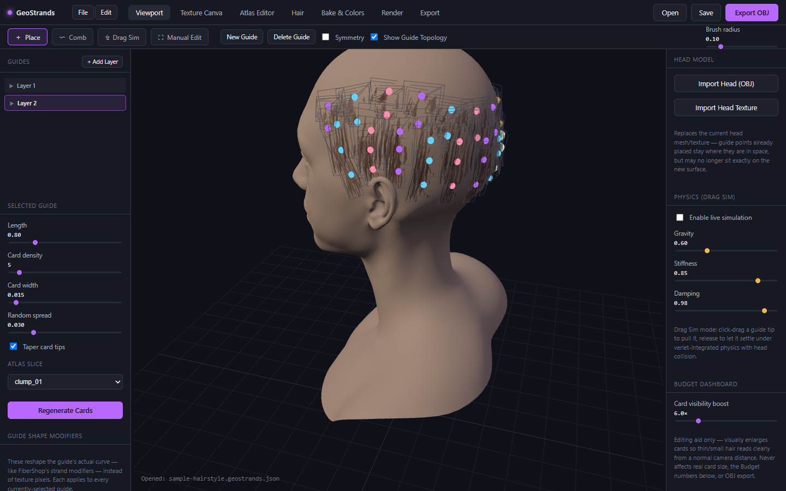
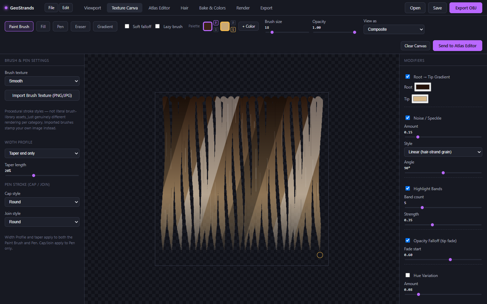
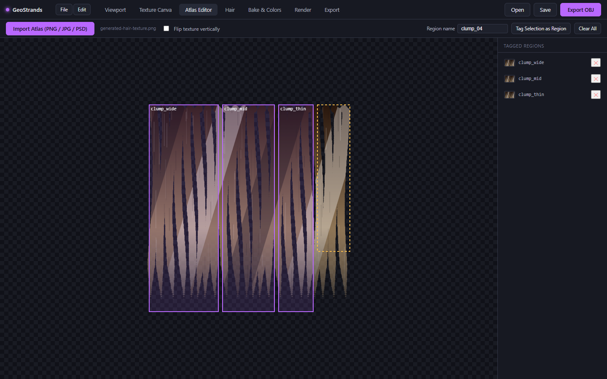
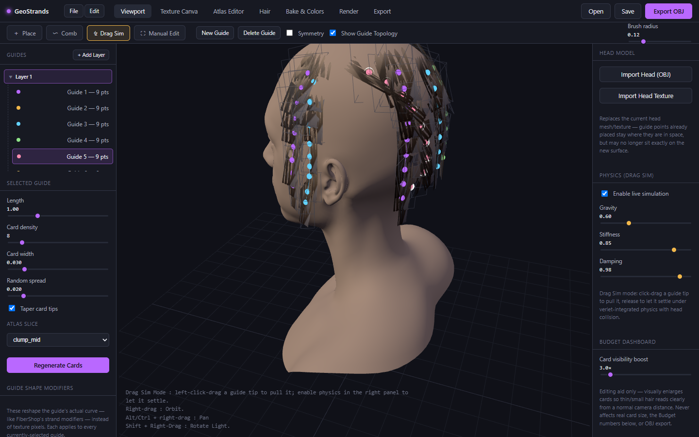
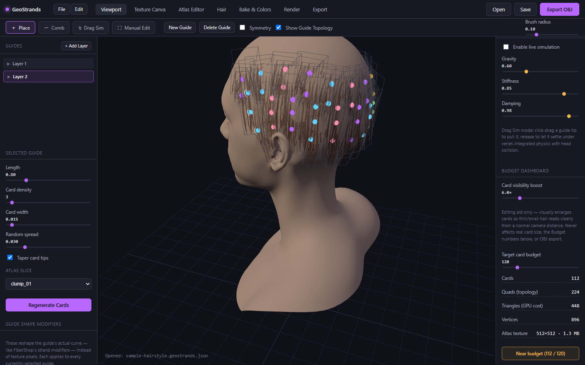
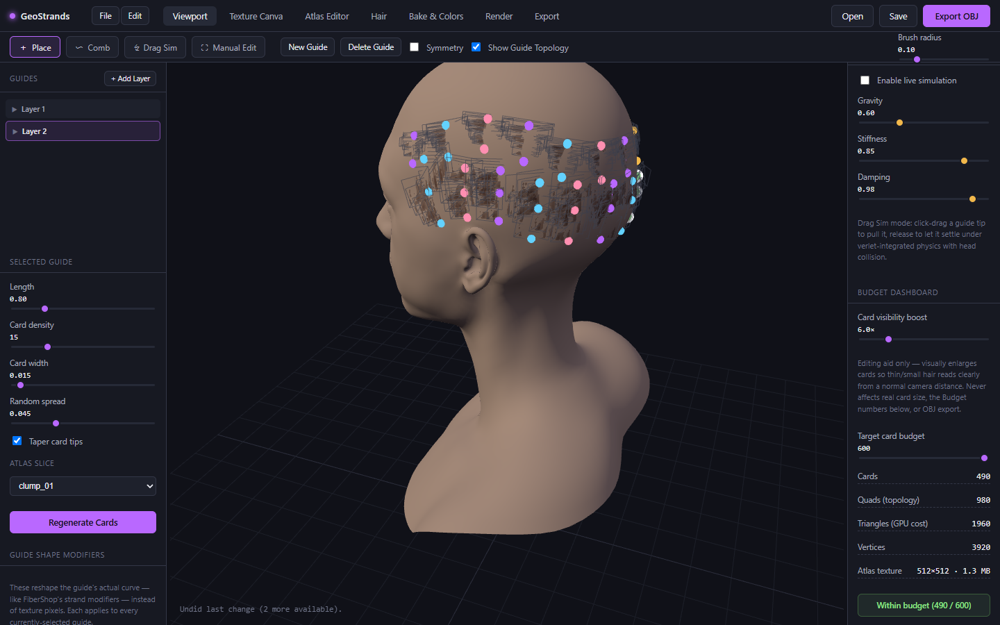

<div align="center">

# GeoStrands

**A hair card authoring tool for real-time games and cinematics.**

Place a few guide curves on a head and GeoStrands builds textured, game-ready hair cards from them. You can style them with comb and physics tools, paint strand textures, pack an atlas, and export to any engine.


[**Download for Windows**](https://github.com/Eviee556/GeoStrands/releases/latest) · [**Try it in the browser**](https://eviee556.github.io/GeoStrands/) · [Tutorials](docs/TUTORIALS.md) · [Examples](docs/EXAMPLES.md) · [Technical docs](docs/TECHNICAL.md) · [How it was made](docs/HOW-IT-WAS-MADE.md)



</div>

> **Work in progress.** GeoStrands is under active development. The core workflow works end to end: guides → cards → texture → atlas → export. Some features are still experimental (FBX/USD export, PSD import), and there are [known issues](docs/TECHNICAL.md#11-known-limitations-and-roadmap).

---

## What it does

Hair cards are textured strips of geometry that stand in for thousands of individual strands. Games and real-time cinematics use them because rendering every strand is too expensive. Placing cards by hand in a DCC tool is slow, repetitive work. GeoStrands automates it:

1. **Place guides.** Click on the scalp to draw sparse guide curves, with optional mirror symmetry and layers.
2. **Generate cards.** Each guide becomes a cluster of cards. You control density, width, random spread and tip taper.
3. **Style.** Comb guides into shape, or turn on **drag physics** (Verlet integration with head collision) and let the hair settle under gravity. Bend, Curl and Noise modifiers reshape guides as well.
4. **Texture.** Paint strand textures in the built-in **Texture Canva**, slice them into regions in the **Atlas Editor**, and assign a slice to each guide.
5. **Preview.** The **Render** tab offers soft shadows, ambient occlusion, ACES tone mapping and bloom.
6. **Export.** Output formats are OBJ + MTL, **glTF binary (.glb)**, ASCII FBX and USD (mesh and guide curves). Texture maps cover albedo, alpha, height, root-to-tip gradient, flow and translucency, with channel packing.

| Texture Canva | Atlas Editor | Drag-sim physics |
|---|---|---|
|  |  |  |

## Built for two pipelines

### Game development: optimized hair cards
- **Budget dashboard.** It shows live card, quad and triangle counts and texture memory against a target budget, so a groom fits its LOD before it leaves the tool.
- **Global density controls.** Scale a whole groom down for a lower LOD in one move. For example, the sample hairstyle drops from 182 to 112 cards at ×0.5 density.
- **Engine-ready output.** glTF imports directly into Unreal, Unity, Godot and Blender with textures embedded. Packed texture maps follow the masks real-time hair shaders expect.



### Cinematics: high-density grooms
- Push density and spread for dense, layered hair, then preview it under filmic lighting with soft shadows and AO.
- Export the actual guide curves as **USD** for downstream strand or groom pipelines alongside the card mesh.



## Getting started

**Windows (no install):**
1. Download `GeoStrands-v0.1.1-win.zip` from [Releases](https://github.com/Eviee556/GeoStrands/releases/latest).
2. Unzip it and double-click **`GeoStrands.exe`**. The app opens in its own window.
3. Load `examples/sample-hairstyle.geostrands.json` with **File → Open Project**.

> The launcher is not code-signed yet, so Windows SmartScreen may warn on first run. Click **More info → Run anyway**.

**Any OS:** open `GeoStrands.html` from the release zip in Chrome, Edge or Firefox. It is a single self-contained file that works offline. You can also use the [browser version](https://eviee556.github.io/GeoStrands/).

**From source:**
```bash
git clone https://github.com/Eviee556/GeoStrands.git
cd GeoStrands
npm install
npm start          # dev server at http://localhost:8080
npm run build      # → dist/GeoStrands.html (single offline file)
npm run package    # → dist/GeoStrands-v<version>-win.zip (Windows, adds the launcher exe)
```

## Documentation

| Doc | What's inside |
|---|---|
| [Tutorials](docs/TUTORIALS.md) | Step-by-step: first groom, styling and physics, textures and atlas, rendering, exporting, shortcuts |
| [Examples](docs/EXAMPLES.md) | Worked examples with pictures: sample groom, game-ready budget, cinematic density, engine import |
| [Technical docs](docs/TECHNICAL.md) | Architecture, data model, card generation, physics, rendering, exporters, build |
| [How it was made](docs/HOW-IT-WAS-MADE.md) | Design goals, decisions and trade-offs, development journey |

## Tech stack

- **JavaScript (ES modules)**, no framework, with **Three.js r160** for WebGL rendering, SSAO, bloom, OBJ loading and glTF export
- Custom writers for OBJ/MTL, ASCII FBX and USDA (mesh and curves)
- Verlet physics with raycast head collision
- **esbuild** bundles the app into one offline HTML file
- A small native **C# launcher** (`GeoStrands.exe`) opens it in a chromeless app window, with no browser framework bundled

```
src/            application source (app.js, atlas.js, texture-gen.js, …)
src/vendor/     three.js and add-ons (unmodified)
scripts/        build and packaging
launcher/       Windows launcher source
examples/       sample project
docs/           documentation and screenshots
```

## Roadmap

- Continuous card strips with proper strand-following orientation
- Binary FBX and full PSD layer import
- LOD generation presets

## Credits

**Created by [Charlize Pauli](https://github.com/Eviee556).** Design, development and documentation.

Built with [three.js](https://threejs.org/) (MIT).

## License

[MIT](LICENSE) © 2026 Charlize Pauli
