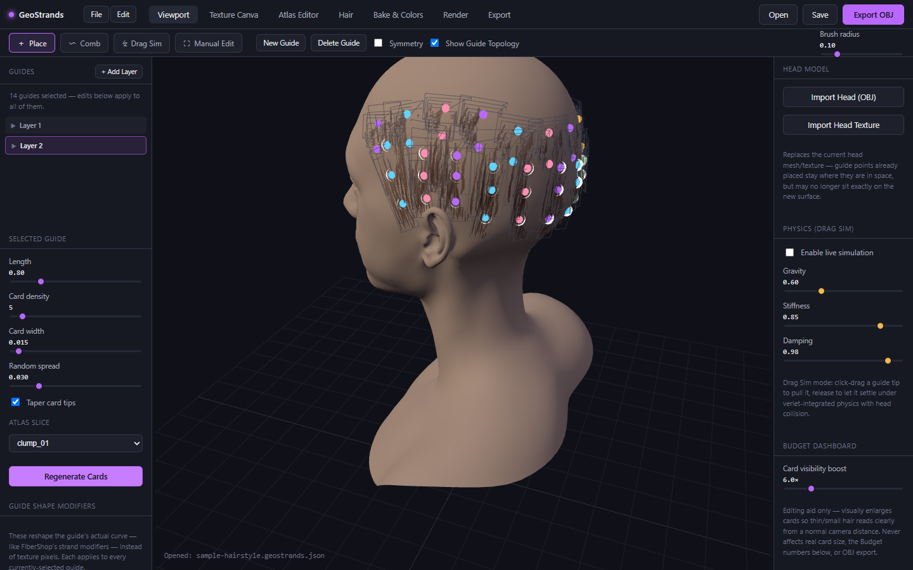
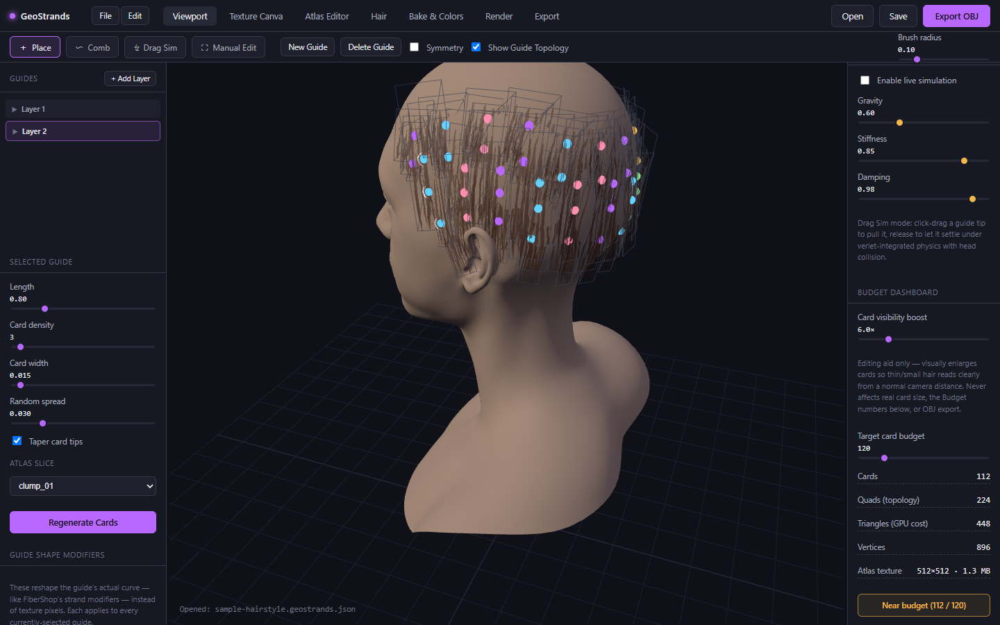
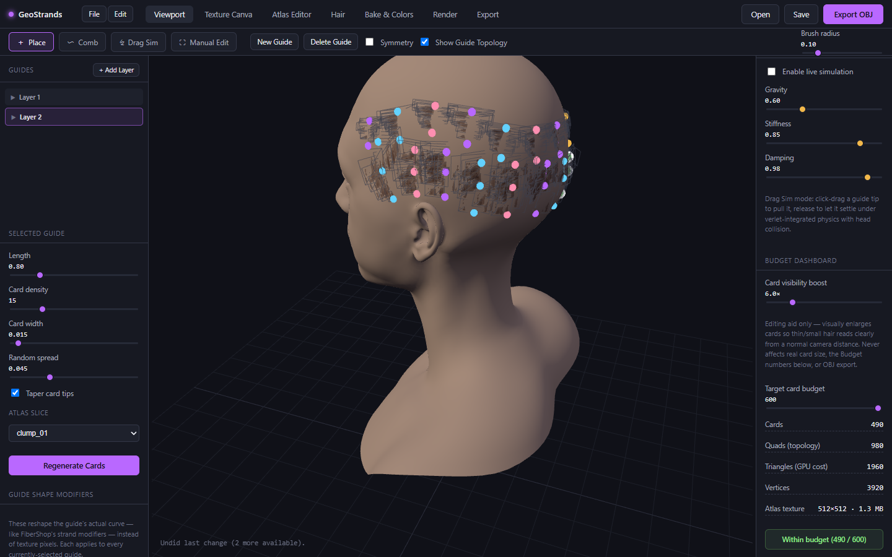
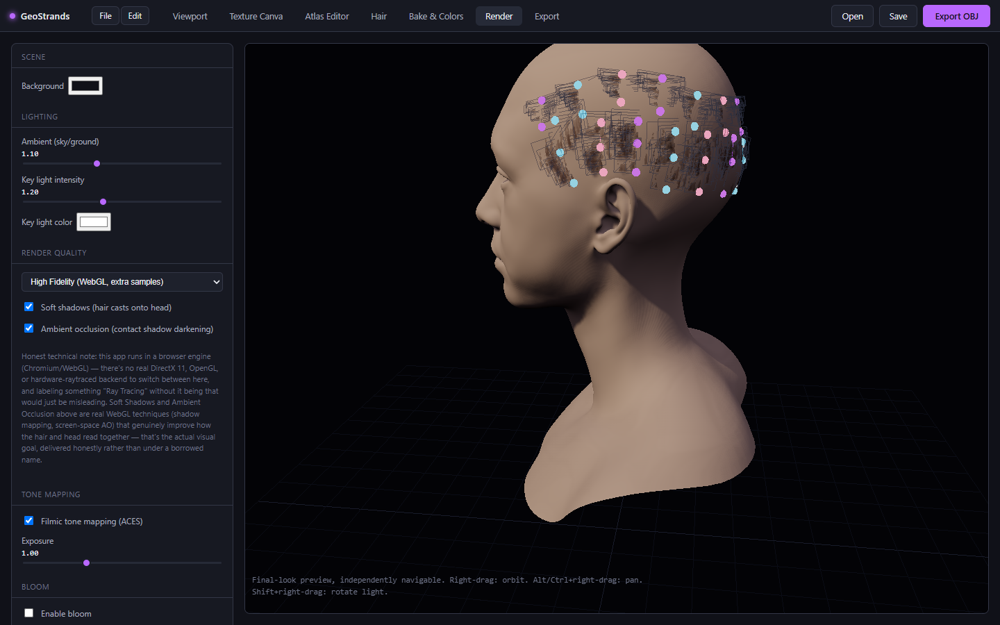
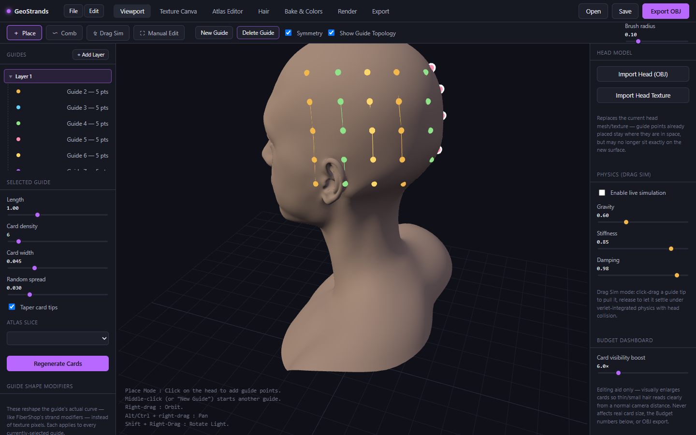
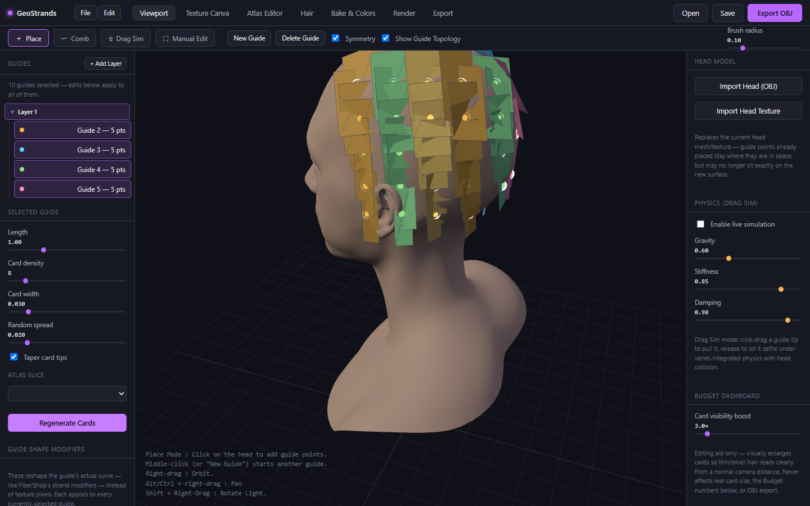
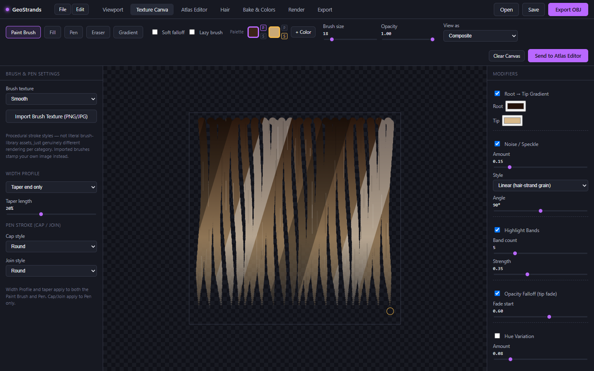
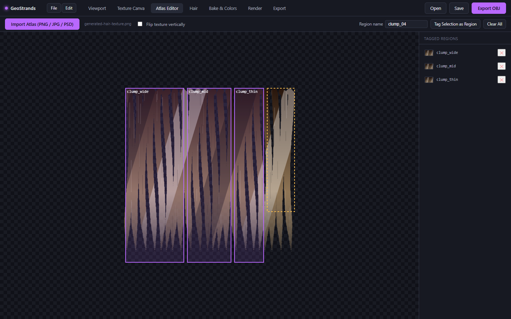
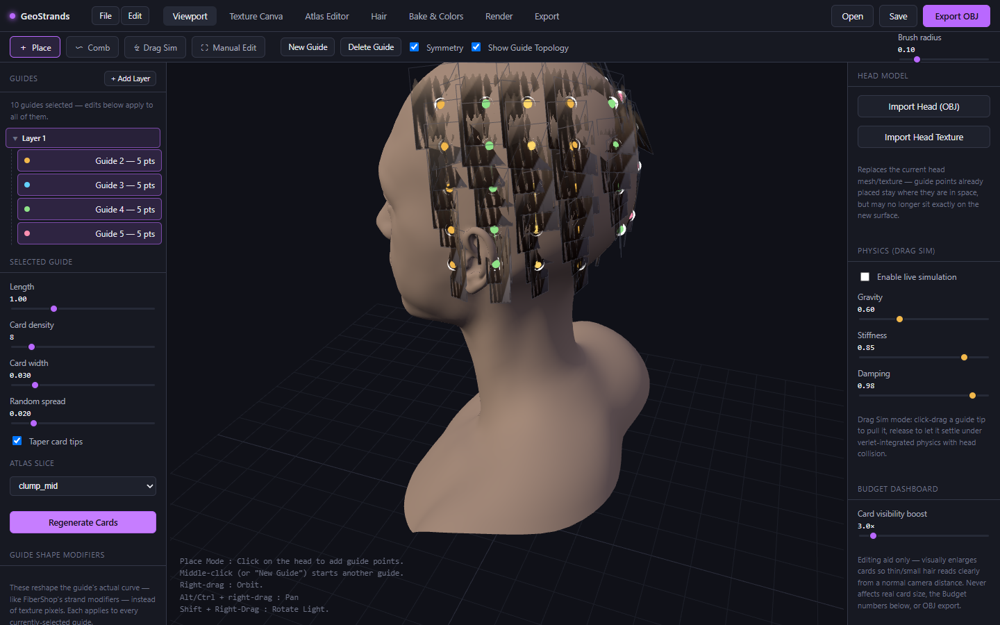
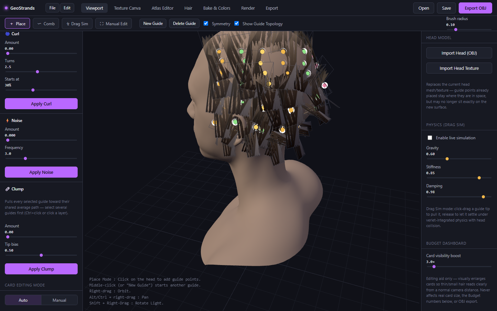

# GeoStrands Examples

Worked examples for GeoStrands, the hair card authoring tool by **Charlize Pauli**. Each one uses only features in the current build. GeoStrands is a **work in progress**, so the numbers below (card and triangle counts) are what this version produces and may change in later releases.

New to the app? Start with [TUTORIALS.md](TUTORIALS.md).

1. [The included sample hairstyle](#1-the-included-sample-hairstyle)
2. [A game-ready, low-budget groom](#2-a-game-ready-low-budget-groom)
3. [A cinematic, high-density groom](#3-a-cinematic-high-density-groom)
4. [From a blank head to a textured groom](#4-from-a-blank-head-to-a-textured-groom)
5. [Getting your hair into Unreal, Unity, Blender and Godot via glTF](#5-getting-your-hair-into-unreal-unity-blender-and-godot-via-gltf)

---

## 1. The included sample hairstyle

**File:** `examples/sample-hairstyle.geostrands.json`

**What's in it:**

| | Layer 1 | Layer 2 |
| --- | --- | --- |
| Guides | 14 (7 mirrored pairs) | 14 (7 mirrored pairs) |
| Points per guide | 2 | 3 |
| Length | 0.7 | 0.8 |
| Card density | 6 | 5 |
| Card width | 0.015 | 0.015 |
| Random spread | 0.005 | 0.03 |
| Taper | on | on |
| Atlas slice | `clump_01` | `clump_01` |

The project also embeds its painted 512×512 atlas with one tagged region, `clump_01`.

**Steps**

1. Click **Open** in the title bar and choose `sample-hairstyle.geostrands.json`.
2. Right-drag to orbit to a side view.
3. Click **Layer 1** in the guide list and press **Regenerate Cards**, then do the same for **Layer 2**. This is a workaround for a current issue: freshly opened projects can show flat-colored cards until you press Regenerate Cards.

**Result:** 182 cards, 728 triangles and 1,456 vertices (14 × 7 cards + 14 × 6 cards). With the default 120-card target, the Budget Dashboard reads *Over budget (182 / 120)*. Examples 2 and 3 start from this point.

Things to try:
- Select a layer and apply **Curl** or **Bend** from *Guide Shape Modifiers*. Run **Subdivide Guide** first, because two-point guides have little to bend.
- Turn off **Show Guide Topology** for a clean look at the cards.

---

## 2. A game-ready, low-budget groom

**Goal:** fit the sample under a real-time budget of about 120 cards (roughly 500 triangles).

1. Open the sample and regenerate both layers, as in Example 1.
2. In the Viewport's right panel, scroll to **Budget Dashboard** and set **Target card budget** to **120**. The status reads *Over budget (182 / 120)*.
3. Go to the **Hair** tab, set **Density ×** to **0.5** and press **Apply to All Guides & Regenerate**.
   - Layer 1 goes from density 6 to 3, and Layer 2 from 5 to 3 (the value is rounded). Each guide now carries 4 cards.
4. Back in **Viewport**, the dashboard shows:

| | Before | After |
| --- | --- | --- |
| Cards | 182 | 112 |
| Triangles | 728 | 448 |
| Vertices | 1,456 | 896 |
| Atlas | 512×512 · 1.3 MB | 512×512 · 1.3 MB |

**Tips for budget grooms**

- The dashboard says *Near budget* above 85% of the target. To get comfortably *Within* it, delete a mirrored pair or two in less visible areas (select them and press Delete) instead of lowering density further.
- Widen the cards (**Card width**) as you remove them, so coverage holds up with fewer cards.
- Keep **Taper** on. It costs nothing and hides the card ends.
- Every card is two-sided (4 triangles), which matters if your engine counts two-sided materials separately. Card counts and triangle counts here are what gets exported. **Card visibility boost** never changes them.
- One 512×512 atlas is shared by every card. That means one texture and one material for the whole groom.

---

## 3. A cinematic, high-density groom

**Goal:** much denser, more overlapping cards for close-up shots.

1. Open the sample and regenerate both layers (or undo the game-ready pass with Ctrl+Z).
2. On the **Hair** tab, set **Density ×** to **3** and **Spread ×** to **1.5**, then press **Apply to All Guides & Regenerate**.
   - Layer 1 goes from density 6 to 18, and Layer 2 from 5 to 15. Spread grows by half, which loosens the strips.
3. Set **Target card budget** to **600**.

| | Sample | Cinematic |
| --- | --- | --- |
| Cards | 182 | 490 |
| Triangles | 728 | 1,960 |
| Vertices | 1,456 | 3,920 |

Higher density splits each guide into **more, shorter** cards (each about 1.35× its segment length, so they overlap). They follow curls and bends much more closely, which is why a cinematic groom pairs well with **Subdivide Guide** followed by **Curl** or **Noise**.

4. Preview it on the **Render** tab with **High Fidelity**, **Soft shadows**, **Ambient occlusion** and **Filmic tone mapping (ACES)** turned on. Shift+right-drag moves the key light to find a good rim angle.

For final frames, more guides beat more density. Use **Scatter** to grow tufts around a hero guide, and **Clump** to pull a group of guides together into readable locks.

---

## 4. From a blank head to a textured groom

A short end-to-end run that uses every authoring tab. The [tutorials](TUTORIALS.md) cover each step in detail.

1. **Guides.** Tick **Symmetry**, orbit to a side view, and place five guides from the crown down past the ear (five clicks each, root to tip). Symmetry mirrors them to the other side, giving 10 guides.

   

2. **Cards.** Click **Layer 1** to select all guides, set density 8, width 0.03 and spread 0.02, and press **Regenerate Cards**. The result is 90 cards and 360 triangles.

   

3. **Texture.** In **Texture Canva**, set the Width Profile to *Taper end only* and paint vertical strokes. Enable *Root → Tip Gradient*, *Noise / Speckle* (Linear), *Highlight Bands* and *Opacity Falloff*.

   

4. **Atlas.** Press **Send to Atlas Editor** and tag three regions: `clump_wide`, `clump_mid` and `clump_thin`.

   

5. **Assign.** In **Viewport**, select the layer, set **Atlas slice** to `clump_mid` and press **Regenerate Cards**.

   

6. **Style.** Run **Subdivide Guide**, then **Curl** (amount 0.06, 2.5 turns, starting at 30%) and a little **Noise**. Use **Comb** for individual strands.

   

7. **Save** the project, then export (see the next example).

---

## 5. Getting your hair into Unreal, Unity, Blender and Godot via glTF

glTF binary (`.glb`) is the format GeoStrands recommends for every engine. It is a single file with the geometry, UVs and atlas texture embedded.

### Export

1. Make sure your cards exist and are textured (an atlas slice is assigned).
2. Open the **Export** tab and press **Export glTF Binary (.glb, textured)**. In the browser, `hair-cards.glb` lands in your Downloads folder.
3. For engines that want separate maps, also run **Export Simple** with Albedo and Alpha (plus Root-Tip or Flow if your hair shader uses them).

What's in the file, based on how the exporter is set up:

- **One mesh per card.** Cards are exported individually at their real size, without the on-screen visibility boost. Each card is two-sided geometry, so no two-sided material flag is needed.
- **A standard PBR material** with the atlas as base color and roughness 0.6. Each guide gets its own material, all pointing at the same texture.
- **Alpha mode BLEND.** The cards use a transparent material, so the glTF alpha mode is BLEND. For card hair you will usually want to switch the material to alpha-clip / masked in the engine, to avoid sorting artifacts.

### Blender

1. **File > Import > glTF 2.0 (.glb/.gltf)** and pick `hair-cards.glb`.
2. Select all the card objects and press **Ctrl+J** to join them into one hair mesh.
3. In the material settings, change the blend mode from *Alpha Blend* to *Alpha Clip* (or *Dithered* in newer Blender versions) if you see sorting problems.

### Unreal Engine

1. Import `hair-cards.glb` through the Content Browser (**Import**). Recent Unreal versions import glTF directly; older ones need the glTF Importer plugin enabled.
2. If the importer offers to combine meshes, turn it on so the groom comes in as one Static Mesh.
3. In the material, set **Blend Mode** to *Masked* and feed the texture's alpha into *Opacity Mask*. For translucency or root darkening, use the extra maps from **Export Simple**.
4. This is card hair, so it imports as a **Static Mesh**, not a Groom asset (Groom assets are for strand-simulated hair).

### Unity

1. Unity doesn't import `.glb` out of the box. Install a glTF importer package (for example *glTFast*), then drop `hair-cards.glb` into your Assets folder.
2. Alternatively, use **Export OBJ + MTL (with texture)**, which Unity imports natively. Then assign `hair-cards_albedo.png` to a material with alpha clipping (*Alpha Clipping* on URP/HDRP Lit, or *Cutout* on Built-in Standard).

### Godot

1. Copy `hair-cards.glb` into your project folder. Godot imports glTF natively and creates a scene you can instance.
2. On the hair material, change **Transparency** from *Alpha* to *Alpha Scissor* for card hair.

### Other formats

- **OBJ + MTL** works almost everywhere. The texture is written as `hair-cards_albedo.png` next to the `.mtl`.
- **FBX (ASCII)** and **USD (.usda)** are marked *experimental* in the app. They were written against the formats' documented text structure without validation in Autodesk or Pixar tools, so try glTF first.
- **Guide Curves (.usda)** exports your actual guide points as USD `BasisCurves`. This is useful in USD-aware tools that can grow strands or a groom from curves.

---

GeoStrands is made by Charlize Pauli (MIT license). It is a work in progress, and feedback and bug reports are welcome.
