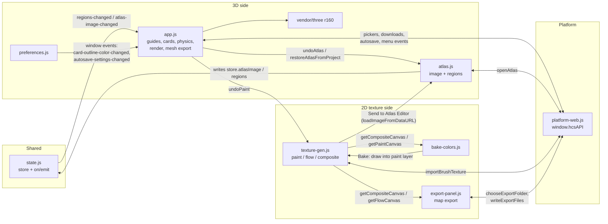

# GeoStrands: Technical Reference

GeoStrands is a browser-based hair card authoring tool. An artist places a few sparse guide curves on a head mesh. The tool turns each guide into a run of textured, two-sided quads ("hair cards") whose count, width, spread and taper come from per-guide settings. Cards are mapped into regions of a texture atlas, can be shaped with a comb tool or a small verlet simulation, and export to OBJ/MTL, GLB, ASCII FBX and USDA. A second half of the app is a 2D texture workbench for painting strand textures and exporting derived maps (alpha, height, root-tip, flow, translucency).

This document describes what the code does today, with references to functions and files in `src/`. The project is version 0.1.2 and is a work in progress. Where the code has a known gap, it is listed in the last section rather than described as working.

---

## 1. Architecture overview

The app is plain ES modules on top of a vendored copy of Three.js r160. There is no framework, no virtual DOM and no build step during development. `index.html` holds all UI markup (seven tabs), and each module finds its own elements with `document.getElementById` when it loads.

| Module | Role |
|---|---|
| `src/platform-web.js` | Classic (non-module) script loaded first. Defines `window.hcsAPI`, the platform layer: file pickers, downloads, autosave storage, the in-page File/Edit menu and Ctrl+S / Ctrl+, shortcuts. |
| `src/state.js` | Shared store (`store.atlasImage`, `atlasImageURL`, `atlasFileName`, `regions`) and a minimal `on` / `emit` event bus. |
| `src/app.js` | Main module: scene, head mesh, guides and layers, card building, guide shape modifiers, pointer tools, Manual Edit, physics, materials, post-processing, the three viewports, mesh/curve exporters, project save/load, autosave, undo, budget dashboard and the render loop. |
| `src/atlas.js` | Atlas Editor tab: loads the atlas image, rubber-band region tagging, the region list and region undo. |
| `src/texture-gen.js` | Texture Canva tab: paint/eraser/pen/fill/gradient tools, width profiles, brush textures, the flow buffer, procedural modifiers and the composite canvas. |
| `src/bake-colors.js` | Bake & Colors tab: brightness/contrast/HSL/invert/remap/solid adjustments on the composite, with an optional bake back into the paint layer. |
| `src/export-panel.js` | Export tab (texture half): simple map export and channel-packed "advanced" export. |
| `src/preferences.js` | Preferences modal: UI theme colors, card outline color, autosave on/off and interval. All stored in `localStorage`. |
| `src/vendor/` | Unmodified Three.js r160 plus addons: `OrbitControls`, `OBJLoader`, `GLTFExporter`, `EffectComposer`, `RenderPass`, `SSAOPass`, `UnrealBloomPass`, `OutputPass` and their shaders. |
| `scripts/build.mjs` | esbuild bundler that inlines everything into one offline `dist/GeoStrands.html`. |

### Module and data-flow diagram



Load order is set in `src/index.html`: `platform-web.js` as a classic script (so `window.hcsAPI` exists before any module runs), then the modules `texture-gen.js`, `bake-colors.js`, `export-panel.js` and `app.js`. `app.js` imports `atlas.js`, `state.js` and `preferences.js` itself.

### The platform layer (`window.hcsAPI`)

Every operation that touches the host goes through `window.hcsAPI`. The app modules never create `<input type=file>` elements, write files or read `localStorage` for project data themselves. The browser implementation in `src/platform-web.js`:

- **Pickers**: `pickFile(accept)` creates a hidden file input and resolves to `null` on cancel. `pickBinary` returns `{ filePath, ext, data }` with base64 data. `pickText` returns `{ filePath, content }`. Exposed as `openAtlas` (`.psd,.png,.jpg,.jpeg`), `importBrushTexture`, `importHeadTexture`, `importHeadModel` (`.obj`) and `openProject` (`.json`).
- **Saving**: `download(filename, blob)` clicks a temporary object-URL anchor. `saveProject`, `exportOBJ`, `exportOBJWithMTL`, `exportGLB` and `exportText` all use it with fixed default file names (`hair-project.geostrands.json`, `hair-cards.obj`, and so on).
- **Folder exports**: browsers cannot write into a chosen folder, so `chooseExportFolder` resolves to the string `'Downloads'` and `writeExportFiles` downloads each file on its own.
- **Autosave**: `autosaveWrite` stores `{ content, mtime }` under `localStorage['geostrands-autosave-v1']`. `getAutosaveInfo` reads it back.
- **Menu**: `buildMenuBar` adds File and Edit dropdowns next to `#titlebar-brand`. Menu items call `fireMenu(name)`, which runs the callbacks registered through `onMenuNewProject`, `onMenuOpenProject`, `onMenuSaveProject`, `onMenuExportObj`, `onMenuLoadAutosave`, `onMenuUndo` and `onOpenPreferences`. Callbacks receive `(null, ...args)`, which keeps the `(event, payload)` signature the original desktop shell's IPC used. `onMenuOpenRecentFile` and `onMenuRecentFileMissing` exist but nothing in the web build fires them.

Because the interface is this narrow, porting from the original desktop shell meant writing this one file. `app.js` and the other modules did not change.

---

## 2. Data model

### 2.1 Guide object

Guides are created by `makeGuide()` in `src/app.js` and kept in the module-level array `guides`.

| Field | Type / default | Meaning |
|---|---|---|
| `id` | int, from `guideCounter++` | Display id ("Guide N" shows `id + 1`). Also picks the color from `GUIDE_COLORS`. |
| `layerId` | int, `activeLayerId` at creation | Owning layer. |
| `color` | hex int | Guide line and point color. Also the flat card color when no atlas is loaded. |
| `points` | `THREE.Vector3[]` | Authored control points. `points[0]` is the root on the scalp. |
| `prevPoints` | `THREE.Vector3[]` | Verlet history, rebuilt whenever its length differs from `points`. |
| `restLengths` | `number[]` | Segment lengths taken at author time by `computeRestLengths`. |
| `locked` | bool, `false` | When `true`, Place mode stops appending points to this guide. |
| `line`, `pointsGroup`, `cardsGroup` | Three.js objects | Scene objects for the preview curve, point markers and cards. |
| `length` | `1.0` (slider 0.2 to 3) | Stretch factor applied away from the root by `getScaledPoints`. Used only for the preview line and cards. Physics, combing and rest lengths use the raw `points`. |
| `density` | `6` (slider 1 to 60) | Number of curve divisions. A guide yields `density + 1` cards. |
| `cardWidth` | `0.045` (slider 0.01 to 0.15) | Base card width in scene units. |
| `spread` | `0.03` (slider 0 to 0.15) | Range of the random sideways offset for each card. |
| `taper` | `true` | Linear width taper from root to tip. |
| `atlasRegionIndex` | `-1` | Index into `store.regions`. `-1` means untextured (the Atlas slice dropdown shows "— none (flat gray) —"). |
| `mirrorOf` | `null` | Paired guide when Symmetry Mode is on. Saved in the project file and undo snapshots as the partner's index in `guides` (`-1` for none) and relinked by `linkMirrors` after a load or undo. |

Edits apply to `guidesToEdit()`: the multi-selection `selectedGuideSet` if it has entries, otherwise the single `selectedGuide`.

### 2.2 Layers

`layers` is an array of `{ id, name, collapsed? }`, starting as `[{ id: 0, name: 'Layer 1' }]`. Layers only group guides. They have no transform and no visibility toggle. Clicking a layer header calls `selectLayerGuides(layerId)`, which selects all of the layer's guides so the property sliders edit them together. `collapsed` is a UI flag that is saved because the whole layer object is serialized.

### 2.3 Atlas regions

`store.regions` (in `src/state.js`) holds `{ name, u0, v0, u1, v1 }` rectangles, normalized from 0 to 1 against the atlas image with **v measured from the top**. `atlas.js` creates them from a canvas drag (the button handler for `#btn-add-region` ignores rectangles smaller than 4 px) and names them `clump_NN` by default. Guides refer to regions **by index**. Deleting a region from the list emits `region-deleted` with its index. `app.js` then shifts down the index of every guide that pointed above it, sets guides that pointed at it to `-1` and rebuilds their cards. Clear All and region undo do not emit this event, so guide indices are left as they were (section 11).

### 2.4 Project JSON schema

`buildProjectJSON()` in `src/app.js` writes:

```text
{
  layers:        [{ id: int, name: string, collapsed?: bool }],
  activeLayerId: int,
  guides: [{
    layerId: int, length: number, points: [[x, y, z], ...],
    density: int, cardWidth: number, spread: number,
    taper: bool, atlasRegionIndex: int,
    mirrorOf: int                  // index of the mirror partner in guides, -1 for none
  }],
  atlas: null | { imageURL: dataURL, fileName: string, regions: [{ name, u0, v0, u1, v1 }] }
}
```

Cards are not saved. `loadProjectFromJSON` rebuilds them with `regenerateCards`, so the random jitter differs after each load. The atlas image decodes asynchronously: `restoreAtlasFromProject` returns the Promise from `loadImageFromDataURL`, and once it resolves, `loadProjectFromJSON` runs `regenerateCards` again on the loaded guides (skipping any deleted in the meantime), so the cards are textured with no user action. `mirrorOf` indices are turned back into guide links by `linkMirrors`. Loading a project, or File > New Project, also empties the guide undo stack and the atlas region undo stack (`clearAtlasUndo`). Manual Edit changes (vertex edits, subdivision, deleted cards), Texture Canva paint, render settings and material tweaks are not saved either, but the current Hair tab values are re-applied to the rebuilt cards (section 5.2). The atlas image is embedded as a data URL, so a project file is self-contained.

### 2.5 Annotated example (`examples/sample-hairstyle.geostrands.json`)

The sample holds 28 guides in two layers, plus a one-region atlas. It is shortened here, and comments are added (real project files are plain JSON):

```jsonc
{
  "layers": [
    { "id": 0, "name": "Layer 1", "collapsed": true },   // collapsed = UI state only
    { "id": 1, "name": "Layer 2", "collapsed": true }
  ],
  "activeLayerId": 0,
  "guides": [
    {
      "layerId": 0,
      "length": 0.7,                 // cards cover 70% of the authored root-to-tip extent
      "points": [                    // 2 points: root on the scalp, then the direction it grows
        [0.1578889152383336, 0.506347086774231, 0.12206486761641061],
        [0.1743582055094417, 0.4591958574058136, 0.1205322270198156]
      ],
      "density": 6,                  // 6 divisions -> 7 cards
      "cardWidth": 0.015,
      "spread": 0.005,
      "taper": true,
      "atlasRegionIndex": 0          // -> atlas.regions[0], "clump_01"
    },
    {
      "layerId": 0,                  // mirror partner of the guide above: same point with x negated
      "length": 0.7,
      "points": [
        [-0.1578889152383336, 0.506347086774231, 0.12206486761641061],
        [-0.1743582055094417, 0.4591958574058136, 0.1205322270198156]
      ],
      "density": 6, "cardWidth": 0.015, "spread": 0.005, "taper": true, "atlasRegionIndex": 0
    }
    // ... 12 more 2-point guides in layer 0 (density 6, length 0.7)
    // ... 14 3-point guides in layer 1 (density 5, length 0.8)
  ],
  "atlas": {
    "imageURL": "data:image/png;base64,iVBORw0KGgo...",   // ~71 KB embedded PNG
    "fileName": "…-hair-texture.png",                    // shortened here; the default name "Send to Atlas Editor" assigns
    "regions": [
      { "name": "clump_01", "u0": 0.1796875, "v0": 0.1904296875, "u1": 0.345703125, "v1": 0.7392578125 }
    ]
  }
}
```

Guides are stored in mirrored pairs, but this sample was saved before the `mirrorOf` field existed, so after loading they are independent guides. Files without the field still load; a file saved now keeps the links. Rebuilt, the sample gives 14 × 7 + 14 × 6 = 182 cards, each with 4 triangles (two-sided), for 728 triangles. That is over the default card budget of 120, so the dashboard shows "Over budget".

---

## 3. Card building

### 3.1 Guide authoring

- **Place mode**: the left-click handler on `#viewport-canvas` raycasts the head (`raycastHead`) and appends the hit point to `selectedGuide.points`, unless the guide is `locked`. When the guide has a `mirrorOf` partner, `mirrorPoint(hit)` (reflection across `x = headCenter.x`) is appended to the partner. Middle-click and the New Guide button call `createNewGuide()`, which locks the previous guide and, with Symmetry Mode on, creates a linked mirror pair.
- **Preview line**: `refreshGuideLine` draws a `CatmullRomCurve3` through `getScaledPoints(guide)` with `max(20, 8 × pointCount)` samples.
- **Shape modifiers** (one-shot buttons, each pushes an undo snapshot and then calls `finishGuideEdit`):
  - `guideDeformBasis(guide)` builds a frame from the overall root-to-tip direction and the outward direction at the root: `right = overallDir × outward` and `normal = right × overallDir`.
  - **Bend**: rotates every point after the root about `right` through the root by `bendDeg × localT`, where `localT` ramps from 0 at the start percentage to 1 at the tip.
  - **Curl**: offsets each point by `(cos θ · right + sin θ · normal) · amount · localT`, with `θ = localT · turns · 2π`.
  - **Noise**: offsets by `sin(wave) · amount` along `right` and `cos(1.3 · wave) · 0.6 · amount` along `normal`, with `wave = t · freq · 2π + phase` and a random phase per guide. Despite the name, this is a deterministic sine wave, not a noise function.
  - **Scatter**: copies `selectedGuide` `count` times. Each copy's root is placed at a random offset within `radius` in the plane tangent to the scalp, projected back to the surface with `headSurfaceRadiusAt`. The other points get uniform jitter of `±randomness × 0.025`. Each copy gets its cards built straight away.
  - **Clump**: resamples every selected guide to 12 points, averages them into a center path, then lerps each guide toward it by `min(1, amount · (1 − tipBias + tipBias · t))`. The root stays where it is.
  - **Subdivide / Unsubdivide**: resamples the raw points with `getSpacedPoints` to `2n − 1` or `round((n + 1) / 2)` points (never fewer than 2).

### 3.2 From curve to cards: `regenerateCards(guide)` in `src/app.js`

The cards are **not camera-facing billboards** and **not one continuous strip**. Each guide becomes a run of separate, slightly overlapping quads, all oriented against the head:

1. **Sampling.** Build `CatmullRomCurve3(getScaledPoints(guide))`. With `n = max(1, density)`, `curve.getSpacedPoints(n)` returns `n + 1` positions spaced evenly by arc length. Tangents come from `curve.getTangent(t)` with `t = i / n` clamped to `[0.001, 0.999]`.
2. **Card size.** `segLength = curve.getLength() / n` and `cardHeight = segLength × 1.35`, so neighboring cards overlap by about 35%, the way hand-placed card strips overlap.
3. **Frame.** For each sample, `outward = normalize(pos − headCenter)`, `right = normalize(tangent × outward)` and `normal = normalize(right × tangent)`. The card plane is spanned by `right` (width) and `tangent` (height), and its face points along `normal`, which is the head-outward direction made perpendicular to the strand. Cards therefore lie roughly flat over the scalp, like real hair cards, and do not turn with the camera.
4. **Taper.** `taperFactor = 1 − 0.55 × i / (samples − 1)`, so the root card has the full `cardWidth` and the tip card 45% of it.
5. **Geometry.** `makeTwoSidedPlaneGeometry(w, cardHeight)` builds a `PlaneGeometry`, clones it, flips the clone's normals and winding, and joins the two with `mergeIndexedGeometries` (8 vertices and 4 triangles per one-segment card). The UVs are remapped (below), then `Matrix4.makeBasis(right, tangent, normal)` is baked into the vertices.
6. **Spread.** `card.position = pos + right × jitter` with `jitter = (rand − 0.5) × spread`. The card is also rotated about the tangent by `rotJitter = (rand − 0.5) × 0.6` rad (±17°). Both values are kept in `card.userData` so `repositionAutoCards` can reuse them.
7. **Material.** One `MeshStandardMaterial` per guide per rebuild, shared by its cards (section 5).
8. **Bookkeeping.** `card.userData` holds `{ jitterQuat, guide, basisMatrix, manualScale, width, height, region, segments: 1, prevLocal, pinnedRow, sampleIndex, jitter, rotJitter }`. `applyCardScale` and `addCardOutline` (a `WireframeGeometry` overlay with raycasting turned off) finish the card.

**Display boost.** `applyCardScale` scales every card by `cardVisibilityBoost × manualScale` (boost default 6×, slider 1 to 25). This only affects the viewport, so thin cards are visible while editing. All exporters reset the scale to `manualScale` first (see `gatherMeshQuadData`, `buildOBJText` and the GLB clone loop), so exported geometry has the real size.

### 3.3 UV mapping into atlas regions: `remapUVs(geometry, region)`

`PlaneGeometry` UVs run from (0,0) at the bottom-left to (1,1) at the top-right of the plane. The plane's +Y edge ends up along the tangent, toward the tip. Each UV is remapped as:

```text
u' = u0 + u · (u1 − u0)
v' = 1 − (v0 + (1 − v) · (v1 − v0))
```

Region v is measured from the top of the image, and the atlas texture keeps the default `flipY = true` (v = 1 at the top). So the tip edge of each card samples the region's top edge (`v0`), and the root edge samples its bottom edge (`v1`). The "flip V" checkbox (`#atlas-flip-v`) is read inside `remapUVs`: when checked, `v` is replaced by `1 − v` before the remap, which flips the strip within its region. Changing the checkbox rebuilds every guide's cards. Because the flip is baked into the UVs rather than set on the texture, exports match the viewport. Guides with no region skip `remapUVs`, so with an atlas loaded they show the whole image and ignore Flip V. Each card maps the **whole** region. The texture is not divided along the guide, so every card in a guide shows the same strip image.

### 3.4 Following a moving guide: `repositionAutoCards(guide)`

The comb tool and the physics step call this function every time the guide moves. It rebuilds the curve, and for each card with `segments === 1` it computes a position with `getPointAt(i / (n − 1))` and a new frame (same construction as above), rebuilds the two-sided plane, re-applies the UV remap and the basis, rebuilds the wireframe outline (`addCardOutline`) so it matches the new geometry, and restores the card's original `jitter` and `rotJitter`. Any manual rotation is kept: `userData.jitterQuat` (saved in `regenerateCards`) holds the jitter-only rotation, the difference between it and the current quaternion is taken as the manual part, and that part is applied again on top of the new jitter rotation. Cards subdivided in Manual Edit are skipped.

### 3.5 Manual Edit mode

With Mode set to Manual:

- The first click selects a card (`selectCard`), using a `raycaster.intersectObjects(allCards())` hit test. Dragging across other cards selects each in turn ("sweep select").
- A second click on the selected card is tested against that card alone. `pickGridSelection` then maps the hit to a vertex, an edge (one row's two vertices) or a face (two adjacent rows), assuming the `row × 2 + col` vertex layout of `PlaneGeometry(w, h, 1, segments)`.
- Dragging moves the selected vertices in screen space along the camera's right/up vectors, scaled by `distance × 0.0015` and divided by the card's display scale.
- **G / S / R** start a modal grab, scale or rotate (`startTransform`, `updateTransformPreview`). X/Y/Z constrain the transform to the card's local axis and draw a dashed axis line. Click or Enter confirms. Esc or right-click cancels and restores the saved state.
- Unsubdivided cards are 8-vertex two-sided geometry (front 0–3, back 4–7 in the same order), and picking only indexes the front. After every drag, grab, scale, rotate or cancel, `syncTwoSidedBackFace` copies the front positions onto the back face, so both sides move together.
- **Subdivide Card** (`rebuildCardGeometry`) replaces the card with a **single-sided** `PlaneGeometry(w, h, 1, segments + 1)` and gives it its own cloned material with `side: DoubleSide`. It also records which end row sits closest to `headCenter` as `pinnedRow`.
- Position/rotation number fields write straight to `card.position` and `card.rotation`. Delete/Backspace removes the selected card.

None of this is covered by undo (section 7).

---

## 4. Physics and grooming

### 4.1 Guide verlet: `stepPhysics(dt)` in `src/app.js`

This runs every frame from `animate`. `dt` is capped at 0.033 s. The simulation runs only while the "physics enabled" checkbox is on (Space toggles it). For each guide with at least 2 points:

1. **Integration** (point 0, the root, is pinned, and so is the point being dragged in Drag mode):
   ```text
   velocity = (current − prev) · damping        // damping slider 0.8 to 1, default 0.98: a retention factor
   next     = current + velocity
   next.y  -= gravity · dt²                     // gravity slider 0 to 2, default 0.6
   ```
2. **Distance constraints**: 3 Gauss-Seidel passes over the segments. Each segment is pulled toward `restLengths[i−1]` (falling back to 0.05) with a correction of `diff · ((dist − rest) / dist) · stiffness · 0.5` on each end. The root and the dragged point are not moved. Stiffness goes from 0.1 to 1 (default 0.85).
3. **Head collision**: for each non-root point, `headSurfaceRadiusAt(dir)` casts a ray from `headCenter` along the point's direction and returns the distance to the first hit on `headMesh` (or `HEAD_RADIUS` = 0.5 if nothing is hit). A point closer than that is pushed out onto the surface. This is why the head material is `DoubleSide`: the ray starts inside the mesh. It works for any head that is star-shaped around its center, either the ellipsoid fallback or an imported OBJ. `headCollisionSkipRadius()` skips the ray for points farther out than every head vertex.

   Head raycasts go through a bounding volume hierarchy from [three-mesh-bvh](https://github.com/gkjohnson/three-mesh-bvh) 0.7.8 (MIT, vendored unmodified in `src/vendor/three-mesh-bvh/` with its LICENSE). `headMesh.raycast` is `acceleratedRaycast`, and `computeBoundsTree()` runs on the ellipsoid fallback and in `applyHeadObjGroup` (default head and Import Head (OBJ)), so Place, Comb, Drag and collision rays all use it. It returns the same hits as the brute-force raycast: the same first hit distance, point and normal. The BVH reorders the head geometry's index buffer, so `faceIndex` values differ, but nothing in the app reads them.
4. Then `syncPointMeshes`, `refreshGuideLine` and `repositionAutoCards`.

**Rest lengths** come from `computeRestLengths`, which runs after authoring moves (place, comb, modifiers, load) and never inside the physics step, so the constraints always pull back toward the authored shape. When the point count changes, the lengths are recomputed.

### 4.2 Comb and Drag tools

- **Comb** (the `mousemove` handler on `#viewport-canvas`): the mouse ray is cast against the head each move, and `delta` is the change from the previous hit. Every point of the selected guide within `brush-radius` (0.02 to 0.5, default 0.1) of the previous hit moves by `delta × (1 − d / radius)`, a linear falloff, and is then lerped 15% toward its own projection on the scalp. That keeps combed points from drifting through or away from the head. Mirror partners get `mirrorDelta(delta)`. Rest lengths are retaken after each move, so combing changes the shape the simulation relaxes back to.
- **Drag**: picks the nearest point within the brush radius on mouse-down and sets it to the head hit position on each move. It is pinned during the physics step while held.

### 4.3 Manual-card gravity

With "manual gravity" on, every card subdivided into 2 or more segments gets the same verlet step in its local space. World down is transformed into the card's frame, every row except `pinnedRow` is integrated, and 3 passes keep each column's row spacing at `height / (rows − 1)`.

---

## 5. Rendering pipeline

### 5.1 Scene

- `WebGLRenderer` with antialiasing and pixel ratio `min(devicePixelRatio, 2)`. The Render Quality "high" setting raises the cap to 3 on all three renderers and both composers.
- `PerspectiveCamera(45°)` with `OrbitControls`. Left mouse is free for tools, right drags orbit, the wheel and middle button zoom. `setupCameraHotkeys` adds Shift+right-drag to rotate the key light around Y, and Alt or Ctrl+right-drag to pan.
- Lights: a `HemisphereLight` (1.1) and a key `DirectionalLight` (1.2) whose 1024² shadow map is sized for the roughly 1-unit head. Shadows are off until "soft shadows" is checked. That sets `PCFSoftShadowMap` on all renderers and flags materials for recompile.
- Head: a `SphereGeometry(0.5)` scaled to an ellipsoid (0.82, 1, 0.9) at `(0, 0.15, 0)`. It is replaced as soon as `OBJLoader` loads `assets/head_placeholder.obj`. `applyHeadObjGroup` merges the sub-meshes (`mergeGeometries`), centers the bounding box and scales the mesh to a height of 1. It keeps the file's normals rather than computing new ones, so smooth shading survives. Users can import their own OBJ head and head texture.

### 5.2 Card materials and alpha

`regenerateCards` creates:

```js
new THREE.MeshStandardMaterial({
  color: tex ? 0xffffff : guide.color,
  map: tex || null,
  transparent: true,
  alphaTest: tex ? 0.35 : 0,
  side: THREE.FrontSide,   // two-sidedness lives in the geometry
  roughness: 0.6,
});
applyHairTabSettings(material);
```

With an atlas loaded, fragments below 0.35 alpha are discarded, and the rest are alpha-blended with depth writes still on. Two-sidedness comes from duplicated, reversed geometry rather than `side: DoubleSide`, so it carries through to OBJ, FBX and USD, which have no standard double-sided flag. The atlas texture is created once per image (`getAtlasTexture`) in `SRGBColorSpace`.

Hair tab adjustments (`hair-tint`, emissive color and intensity, roughness) change the existing card materials through `forEachUniqueCardMaterial`. `applyHairTabSettings` also applies the current values to every new material in `regenerateCards`, so they survive Regenerate Cards, undo and project load. A pure-white tint counts as untouched and leaves the base color alone (white with an atlas, the guide color without). "Apply global hair" multiplies density and spread, overrides taper and rebuilds the cards.

### 5.3 Post-processing

`EffectComposer` → `RenderPass` → `SSAOPass(512×512)` → `UnrealBloomPass(strength 0.6, radius 0.4, threshold 0.85)` → `OutputPass`. SSAO and bloom start disabled. In `animate`, the composer is used only when bloom or AO is on, and the cheaper `renderer.render` path is used otherwise. Tone mapping is off by default. The Render tab can switch on `ACESFilmicToneMapping` and set exposure on all three renderers, plus background color, light intensities and key light color.

### 5.4 Secondary preview viewports

The Hair and Render tabs each have their own `WebGLRenderer` on a separate canvas, a camera cloned from the main camera, and their own `OrbitControls`. They render the **same `scene`**, so no geometry is duplicated, and navigation is independent. The Render tab also has its own composer (`renderPreviewComposer`), because an `EffectComposer` is tied to one renderer. Its SSAO and bloom passes follow the same toggles as the main ones. `animate` renders only the preview of the active tab, and `resizeSecondaryViewport` resizes it only when the wrapper size changes. Each preview render is wrapped in try/catch so a failure there cannot stop the main loop.

An optional stats overlay shows smoothed FPS (`0.9 · old + 0.1 · new`) plus guide, card, quad and triangle counts. `animate` moves the overlay element into the Render tab preview (`#render-viewport-wrap`) while that tab is active, and back to the main viewport (`#viewport-canvas-wrap`) otherwise. In the Render tab, the settings column (`#render-panel`, `align-self: stretch`) scrolls on its own, so the preview stays in view.

---

## 6. Exporters

### 6.1 Mesh exporters (`src/app.js`)

All mesh exporters use world-space card vertices at true scale (`manualScale` only, no display boost) and restore the boost afterwards.

**Quad rebuild.** Card geometry is always plane grids, so every 6 indices are two triangles that share a diagonal. `buildOBJText` and `gatherMeshQuadData` find each triangle's unique corner, then walk the first triangle's own winding from its unique corner `k`: the quad is `[uniq1, tri1[k+1], uniq2, tri1[k+2]]` (indices mod 3). The quad therefore keeps the face's winding, so the reversed back faces stay reversed and both sides face the right way. If the pattern does not match, `buildOBJText` falls back to two triangles.

| Format | Function | What it writes |
|---|---|---|
| OBJ | `buildOBJText(false)` → `hcsAPI.exportOBJ` | One object `hair_cards`, `v` and `vt` per vertex, `f a/a b/b c/c d/d` quads. No normals. |
| OBJ + MTL | `buildOBJText(true)`, `buildMTLText`, `getCompositeTextureBase64` → `hcsAPI.exportOBJWithMTL` | Adds `mtllib hair-cards.mtl` and a `usemtl guide_<index>` block for each guide that has cards. The MTL has `illum 2`, `Kd 1 1 1` and, if an atlas is loaded, `map_Kd` and `map_d` set to `hair-cards_albedo.png`. That PNG is the atlas image (`store.atlasImage`) redrawn to a canvas. |
| GLB | `GLTFExporter.parse(..., { binary: true })` → `hcsAPI.exportGLB` | Copies of every card (shared geometry, real scale) in a throwaway `Group`, so the live scene is never touched. Each live material is cloned once with `transparent: false`, so the exporter writes `alphaMode: MASK` with `alphaCutoff: 0.35` (from `alphaTest`) instead of BLEND. A black or zero-intensity emissive is normalized to black at intensity 1, so no empty `KHR_materials_emissive_strength` is written. Textures are embedded. The output passes the Khronos glTF validator with 0 errors and 0 warnings. The `ArrayBuffer` is base64-encoded for the platform call. |
| FBX (ASCII 7.4) | `gatherMeshQuadData` → `buildFBXAscii` → `hcsAPI.exportText` | One `Geometry::hair_cards` with `Vertices`, `PolygonVertexIndex` (last index of each polygon stored as `-(i+1)`), per-polygon-vertex face normals from the first three quad corners, `IndexToDirect` UVs, one Phong material, a `Model`, a `Definitions` section (Geometry, Model and Material counts) and `OO` connections, including the model's connection to the scene root (`0`). No texture node is written. `UpAxis = 1` (Y), `UnitScaleFactor = 100`. It parses cleanly in the three.js `FBXLoader`, but is still marked best-effort in code and UI because it has not been checked in Autodesk tools or Blender. |
| USDA mesh | `buildUSDAMesh(meshData, textureFileName)` | `Xform "hair_cards"` / `Mesh "cards"` (with `prepend apiSchemas = ["MaterialBindingAPI"]`, `subdivisionScheme = "none"`, `doubleSided = 1`) with `faceVertexCounts` (all 4), `faceVertexIndices`, `points` and face-varying `primvars:st`. With an atlas there is also a `UsdPreviewSurface` whose `diffuseColor` and `opacity` come from a `UsdUVTexture` on `hair-cards_usd_albedo.png`, read through a `UsdPrimvarReader_float2` (`string inputs:varname = "st"`), with `opacityThreshold = 0.5`, and the texture is written next to the file. Layer metadata: `metersPerUnit = 1`, `upAxis = "Y"`. Passes `UsdValidation`. |
| USDA curves | `buildUSDACurves()` | `BasisCurves "hair_guides"`, `type = "linear"`, `curveVertexCounts` per guide, the **raw** guide points (no `length` scaling) and one constant `widths` value, the average `cardWidth` of the exported guides. `metersPerUnit = 1`, `upAxis = "Y"`. This is real strand data for USD-aware DCC tools and groom-style pipelines. |

OBJ output loads cleanly in the three.js `OBJLoader`.

### 6.2 Texture map exporters (`src/export-panel.js`)

All maps come from the Texture Canva **composite** canvas (`getCompositeCanvas`), which is 512 × 512. `getMapSourceCanvas` checks it first: if an atlas image is loaded and the composite is fully transparent (nothing painted), the maps are built from the atlas image instead, at the atlas image's size, so they match the textured cards. `channelValue(key, …)` defines the channel math:

| Key | Value (0 to 255) |
|---|---|
| `alpha` | `A` |
| `translucency` | `255 − A` (an approximation: thin, transparent areas let more light through) |
| `luminance` (Height) | `0.299 R + 0.587 G + 0.114 B` (Rec. 601 luma used as a height stand-in) |
| `roottip` | `y / (h − 1) · 255`: a vertical ramp, black at the top (root) and white at the bottom (tip) |
| `red` / `green` / `blue` | the matching channel |
| `flowx` / `flowy` | R / G of the flow buffer |
| `white`, `black`, `empty` | 255, 0, 0 |

- **Simple export** writes `<prefix>_Albedo/Alpha/Height/RootTip/Flow/Translucency.png`. Single-channel maps are grayscale with alpha set to 255 (`buildSingleChannelCanvas`). The flow map is the flow buffer copied as is (`buildFlowMapCanvas`).
- **Advanced export** (`buildPackedCanvas`) packs any key into R, G, B and A for each output image. The default output is "Mask" = R alpha, G luminance, B root-tip, A empty. An `empty` alpha is written as 255 so the PNG previews normally.

**Flow buffer** (`src/texture-gen.js`). Starts filled with `rgb(128,128,128)` (no direction). Each Paint Brush dab writes `R = (dx · 0.5 + 0.5) · 255` and `G = (dy · 0.5 + 0.5) · 255` from the normalized stroke direction (`stampFlowDab`, only when the pointer moved more than 0.5 px). Dabs are interpolated between pointer events at 25% of the brush diameter, and the stroke's first segment is recorded too. A Pen stroke cancelled with Esc still leaves its flow lines in the buffer. Each Pen segment does the same along the segment (`stampFlowLine`). Fill and gradients do not write to it.

### 6.3 Texture Canva compositing (`src/texture-gen.js`)

Three canvases: `paint` (the strokes themselves), `compositeCanvas` (paint plus modifiers) and the visible canvas (the composite, or one channel of it, depending on "View as"). `computeComposite` always starts again from `paint`, so modifiers never stack on their own output. In order:

1. **Root-tip gradient**: a vertical linear gradient from the root color to the tip color, drawn with `source-atop`, so it recolors only painted pixels.
2. **Highlight bands**: `count` slanted parallelograms in alternating white and black at `globalAlpha = strength`, with `source-atop`.
3. **Opacity falloff**: `destination-in` with a vertical gradient from opaque (until the start value) to transparent at the bottom, which multiplies the existing alpha.
4. **Linear noise**: `80 + 400 · amount` random dark or light streaks at the chosen angle, with `source-atop`.
5. **Pixel pass** (`applyPixelModifiers`): dot noise adds `(rand − 0.5) · 255 · amount` to RGB, and hue jitter shifts each pixel's HSL hue by `(rand − 0.5) · amount`. Fully transparent pixels are skipped.

`rand` in steps 4 and 5 is a mulberry32 PRNG reseeded with a fixed seed at the start of every `computeComposite`, so the same paint and settings always give the same pixels and exports are reproducible. Brush dabs are not seeded: the ink and textured brush styles still use `Math.random` while you paint.

The brush tools: dabs along the recorded path, interpolated so they are never more than 25% of the brush diameter apart (`drawTaperedStroke`), so fast strokes leave no gaps. The overlap makes semi-transparent brush styles build up slightly denser. Each dab's radius comes from `widthProfileFactor(t, profile, taperFrac)` (uniform, taper start/end/both, `sin(πt)`, `1 − 0.85 sin(πt)`, or a custom quadratic Bezier curve, never below 0.05). There are brush texture variants (smooth, watercolor, marker, ink, textured, or an imported stamp tinted with `source-atop`), an optional lazy-brush stabilizer (the anchor follows the pointer only after it leaves `lazyRadius`), a true stroked path for untapered Pen strokes (respecting cap and join), a 4-way stack flood fill with an RGBA tolerance of 40, and gradient shapes. Linear, radial, triangle and ellipse use canvas gradients. Square (Chebyshev distance) and diamond (Manhattan distance) are filled pixel by pixel.

### 6.4 Bake & Colors (`src/bake-colors.js`)

`buildTargetImageData` turns the composite into the chosen target (albedo, or alpha / height / root-tip shown as gray, keeping the real alpha). `applyAdjustments` then runs on every non-transparent pixel: brightness `+b · 2.55`; contrast with the standard factor `259(C + 255) / (255(259 − C))`, where `C = contrast · 2.55`; HSL saturation offset and hue rotation; invert; a gradient remap that lerps from the dark color to the light color by luma; and a solid-color override. **Bake** is allowed only for the albedo target. It draws the adjusted result back into the `paint` canvas and resets the sliders.

---

## 7. Undo

There are three separate snapshot stacks. Which one Ctrl+Z (or Edit > Undo) uses depends on the active tab:

| Tab | Stack | Depth | Snapshot |
|---|---|---|---|
| Texture Canva | `paintUndoStack` (`texture-gen.js`) | 30 | `paint.toDataURL()` and the flow buffer's `toDataURL()` |
| Atlas Editor | `regionUndoStack` (`atlas.js`) | 30 | `JSON.stringify(store.regions)` |
| All other tabs | `undoStack` (`app.js`) | 50 (`MAX_UNDO`) | `serializeState()`: layers, active layer, guide fields as in the project file (including `mirrorOf`) |

`pushUndoSnapshot()` runs before discrete actions. For continuous gestures (slider drags, comb and drag strokes), `beginUndoableEdit()` pushes one snapshot and sets `snapshotPending` until the next `mouseup`, so a whole drag is one undo step. `restoreState` tears down every guide and rebuilds them with `makeGuide` and `regenerateCards`. Card jitter is random again, guide ids are renumbered from 0, and `linkMirrors` restores the mirror pairs. New Project and Open Project empty both `undoStack` and `regionUndoStack` (`clearAtlasUndo`), so Ctrl+Z cannot reach back into the previous project.

Not covered: Manual Edit card and vertex edits, G/S/R transforms (which have their own Esc cancel), and render and material settings.

---

## 8. Autosave and preferences

`restartAutosaveTimer` (in `app.js`) sets `setInterval(performAutosave, minutes × 60000)` using `getAutosaveEnabled()` (default on) and `getAutosaveIntervalMin()` (default 15). It restarts on the `autosave-settings-changed` window event from `preferences.js`. `performAutosave` does nothing if there are no guides. Otherwise it writes `buildProjectJSON()` through `hcsAPI.autosaveWrite`, which in the browser is a single `localStorage` slot. Autosave never touches the user's own saved file. File > Load Autosave shows the timestamp, asks for confirmation and loads with `filePath = null`, so the recovery copy does not become the current project.

`preferences.js` stores the theme as CSS custom properties (`--bg-0`, `--bg-1`, `--thread`, `--gold`) under `hcs-theme-v1` and applies them inline on `<html>`. It also stores the card outline color (`hcs-card-outline-color`) and the autosave settings.

---

## 9. Performance and budget dashboard

`updateBudgetDashboard()` in `src/app.js` counts the actual scene geometry rather than estimating it:

- **Cards** = total `cardsGroup.children` across guides.
- **Tris** = Σ `index.count / 3` over each card's geometry. A one-segment auto card has 4 triangles, because the back face is real geometry.
- **Quads** = tris / 2.
- **Verts** = Σ `position.count` (8 per auto card, `2 × (segments + 1)` per subdivided card).
- **Texture memory** = `w × h × 4 × 1.33 / 2²⁰` MB for the atlas image: RGBA8 plus about a third for the mip chain, one texture shared by every card. For example, a 512 × 512 atlas is about 1.3 MB.
- **Status** compares the card count to the budget target (slider 20 to 600, default 120): "within" at 85% or less, "near" up to 100%, "over" above that.

It runs after card rebuilds, deletions, undo and load, and on `regions-changed` and `atlas-image-changed`. The Hair tab summary (`updateHairSummary`) and the stats overlay count the same way.

Per-frame costs to be aware of: while physics is on, every guide point does one raycast against the head mesh each frame, and every card on every moving guide is repositioned (`repositionAutoCards`). On the sample project (182 cards, 48,004-triangle head, headless Chrome with software WebGL) the BVH cut one head raycast from 3.75 ms to 0.017 ms, a physics step from 333 ms to 5.1 ms and the frame time with live simulation on from 204 ms to 47 ms. Repositioning all cards costs about 2 ms per step.

---

## 10. Build pipeline (`scripts/build.mjs`)

- **Development**: `npm start` serves `src/` with `http-server` (cache off). ES modules do not load over `file://`, so a server is needed.
- **Build**: `npm run build` runs esbuild with a stdin entry that imports `texture-gen.js`, `bake-colors.js`, `export-panel.js` and `app.js`, in that order. Output is bundled, minified ESM with no legal comments, kept in memory (`write: false`).
- **Inline head mesh**: a small esbuild plugin (`inline-head-obj`) replaces the string literal `'./assets/head_placeholder.obj'` in `app.js` with a `data:text/plain;base64,…` URL, so `OBJLoader` can fetch it with no server.
- **HTML assembly**: `index.html` gets the stylesheet inlined as `<style>`, the app icon as a data URL and `platform-web.js` as an inline classic script. The import map and the external module tags are removed (esbuild aliases the bare `three` import that three-mesh-bvh uses to `src/vendor/three.module.js`, so the bundle holds one copy of three.js), and the bundle goes into one `<script type="module">` before `</body>`. The script aborts if a `src="app.js"` tag is still there.
- **Output**: `dist/GeoStrands.html` (about 5 MB), which opens by double-click and runs fully offline.
- **CI**: `.github/workflows/pages.yml` builds on every push to `main` and publishes the file as `index.html` on GitHub Pages.

---

## 11. Known limitations and roadmap

Limitations visible in the current code:

- **Cards are separate quads, not continuous strips.** Every card in a guide maps the same full region. There is no UV split along the guide and no strip with shared vertices.
- **Orientation comes only from the head center.** The card plane uses `pos − headCenter` as "up". There is no parallel-transport frame and no per-guide twist control. `rotJitter` is the only twist.
- **No camera-facing mode.** Cards are fixed in world space.
- **Manual Edit is not saved or undoable.** Subdivided cards are single-sided in exports.
- **Alpha in the viewport**: `transparent: true` together with `alphaTest` blends with depth writes on, so sorting artifacts are possible on screen. glTF export is not affected: it clones each material with `transparent: false`, so `GLTFExporter` writes `alphaMode: MASK` with `alphaCutoff: 0.35`.
- **Brush randomness**: Texture Canva modifiers are seeded, but the ink and textured brush styles use `Math.random` per dab, so repainting the same stroke gives slightly different pixels.
- **PSD import** is best-effort (the browser decodes the image). Flattened PNG is recommended.
- **Export validation**: GLB passes the Khronos glTF validator (0 errors, 0 warnings), USDA passes `UsdValidation`, and OBJ and FBX parse cleanly in the three.js loaders. FBX has not been tested in Autodesk tools or Blender, and it has no texture node, so the material comes in untextured.
- **Atlas region indices**: undoing a region delete restores the region but not the guide links that the delete reset to `-1`. Clear All does not reset guide indices, so guides keep pointing at indices that no longer exist.
- **Guides with no region** map the whole atlas image when one is loaded, and Flip V does not affect them.
- **Browser limits**: folder exports become individual downloads, there is one autosave slot in `localStorage`, and "recent files" is not available.
- **Physics** has no guide-to-guide collision, no wind and and no per-guide stiffness. Collision still casts one ray per guide point per step. The BVH makes each ray cheap, but the cost still grows with point count.

Next steps, in priority order:

1. Continuous card strips with UVs that run the length of the region, plus a parallel-transport frame with a twist control.
2. Saving Manual Edit changes in the project file and covering them in undo, and keeping guide region links intact through region undo and Clear All.
3. An optional alpha-to-coverage or sorted path for cinematics.
4. A proper PSD decoder and multi-atlas support.
5. Collision against an SDF instead of per-point raycasts.
6. Checking the FBX output in Autodesk tools and Blender and adding a texture node, testing USD in target DCC tools and engines, and LOD card reduction for game budgets.
