# GeoStrands Tutorials

GeoStrands is a hair card authoring tool by **Charlize Pauli**. It runs in the browser (Three.js / WebGL) and covers the whole card-hair loop: place guide curves on a head, generate cards along them, style the guides with comb and physics tools, paint a strand texture, cut it into atlas regions, preview the result, and export it to game engines and DCC tools.

> GeoStrands is a **work in progress**. Features change between versions and some exporters (FBX, USD) are marked experimental in the app itself. If something here doesn't match what you see, the app is probably ahead of (or behind) these docs.

Contents

1. [Getting started](#1-getting-started)
2. [Your first hair groom](#2-your-first-hair-groom)
3. [Styling with Comb and Drag Sim physics](#3-styling-with-comb-and-drag-sim-physics)
4. [Creating a strand texture and atlas](#4-creating-a-strand-texture-and-atlas)
5. [Previewing and rendering](#5-previewing-and-rendering)
6. [Exporting to engines](#6-exporting-to-engines)
7. [Keyboard and mouse shortcuts](#7-keyboard-and-mouse-shortcuts)

---

## 1. Getting started

### Running the app

**From a release (no install).** Download the release and double-click `GeoStrands.html`. Everything (Three.js, the head model, the UI) is bundled into that one file, so it opens directly in any modern browser (Chrome, Edge or Firefox). No server or internet connection is needed.

**From source.** You need Node.js.

```bash
npm install
npm start          # serves src/ on http://localhost:8080 and opens it
npm run build      # writes the single-file app to dist/GeoStrands.html
```

### The screen

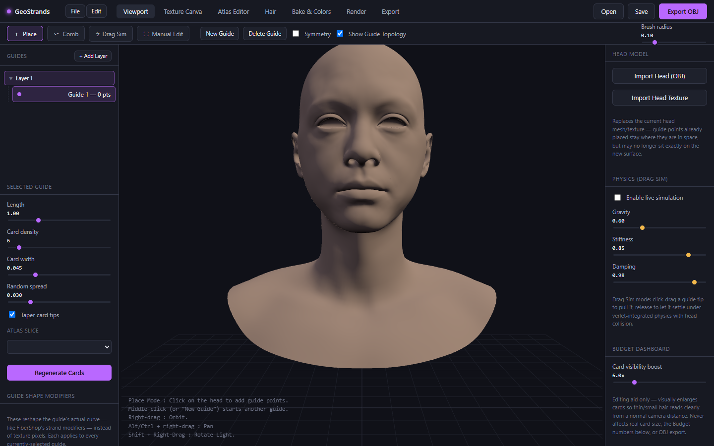

- **Title bar**: the in-page **File** and **Edit** menus, the seven tabs (*Viewport, Texture Canva, Atlas Editor, Hair, Bake & Colors, Render, Export*) and the **Open / Save / Export OBJ** buttons. You can drag tabs to reorder them.
- **Toolbar** (Viewport tab): the four tool modes **Place**, **Comb**, **Drag Sim** and **Manual Edit**, plus **New Guide**, **Delete Guide**, **Symmetry**, **Show Guide Topology** and **Brush radius**.
- **Left panel**: the guide list (grouped into layers), the *Selected Guide* settings, *Guide Shape Modifiers* and *Card Editing Mode*.
- **Right panel**: *Head Model* import, *Physics (Drag Sim)* and the *Budget Dashboard*.
- **Bottom-left hint**: tells you what the current mode does and reports results (saved, exported, undone).

### Projects

- **Save** downloads a `hair-project.geostrands.json` file containing layers, guides, per-guide settings and the atlas image with its regions.
- **Open** loads one of those files back. Try `examples/sample-hairstyle.geostrands.json` from the repository.
- **File > Load Autosave…** restores the last autosave. Turn autosave on under **Edit > Preferences…** (Ctrl+,). In the browser build it is kept in the browser's local storage and never overwrites your own saved file.

You can also use your own head mesh: **Import Head (OBJ)** and **Import Head Texture** in the right panel replace the default head. Guide points you already placed stay where they are in space.

---

## 2. Your first hair groom

A **guide** is a curve you click onto the scalp. GeoStrands generates a strip of **hair cards** along each guide. Every guide has its own length, card density, width, spread, taper and atlas slice.

### Step 1: Place guides

1. Stay in **Place** mode (the default).
2. Optionally tick **Symmetry**. Each **New Guide** then gets a mirrored twin across the head's center line, and the twin follows every point you add.
3. Press **New Guide** (or middle-click in the viewport) to start a guide.
4. Left-click on the head from the **root** (scalp) toward the **tip**. Each click adds a point on the head surface.
5. Press **New Guide** again for the next strand. The previous guide is locked so further clicks can't add to it.

Right-drag orbits the camera so you can reach the sides and back of the head. The mouse wheel zooms.

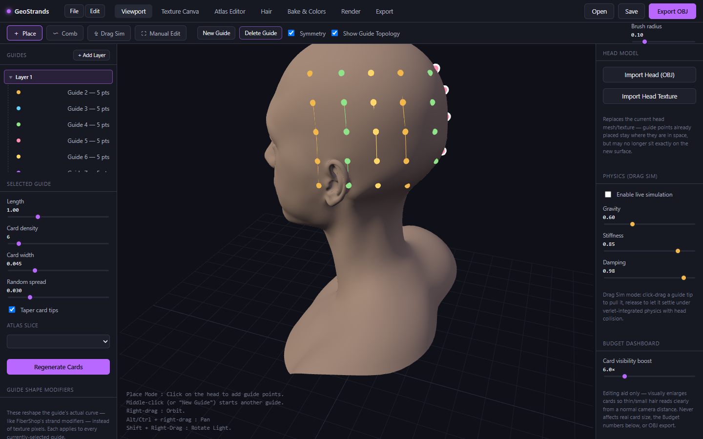

The guide list shows each guide with its point count. Click a guide to select it, Ctrl+click to add or remove it from a multi-selection, or click a **layer** row to select every guide in that layer. **+ Add Layer** creates a new layer, and new guides go into the active layer.

### Step 2: Generate cards

With guides selected, set the *Selected Guide* sliders and press **Regenerate Cards**. Slider and checkbox changes apply to every selected guide.

| Setting | What it does |
| --- | --- |
| **Length** | Scales the guide curve before cards are built along it (0.2 to 3). |
| **Card density** | How many card segments the guide is split into (1 to 60). Each guide gets *density + 1* cards, and each card is about 1.35× its segment long so neighbors overlap. Higher density gives more, shorter cards that follow curves more closely. |
| **Card width** | Card width in scene units (0.01 to 0.15). |
| **Random spread** | Random sideways offset per card, which breaks up the strip so it reads less like a ribbon. |
| **Taper card tips** | Narrows cards toward the tip, down to 45% width at the last card. |
| **Atlas slice** | Which tagged atlas region the cards use. With **— none (flat gray) —** selected, cards are drawn in the guide's flat color. |

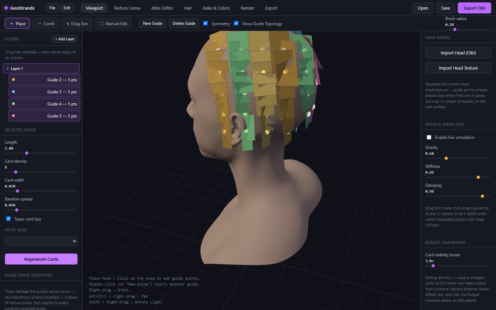

Cards are two-sided geometry, so they show from both directions and export that way.

> **Card visibility boost** in the Budget Dashboard only enlarges cards *on screen* so thin hair is easier to see while you work. It never changes real card size, the budget numbers or the exported geometry. The screenshots here use 3× to 6×.

### Step 3: Shape the guides

**Guide Shape Modifiers** reshape the actual curve points of every selected guide, then regenerate their cards:

- **Subdivide / Unsubdivide Guide**: roughly doubles or halves the point count along a smooth curve. Subdivide before using Curl or Noise so they have points to work with.
- **Scatter**: duplicates the selected guide into a tuft of new guides near its root (count, spread radius, shape randomness). This is the only modifier that adds guides.
- **Bend**: rotates the guide from a start percentage toward the tip by up to ±90°.
- **Curl**: spirals the guide (amount, turns, start percentage).
- **Noise**: adds random jitter to the points (amount, frequency).
- **Clump**: pulls several selected guides toward their shared average path, with a tip bias.

After you press **Apply**, the modifier sliders reset to neutral, so applying again doesn't double the effect. Every modifier is undoable with Ctrl+Z.

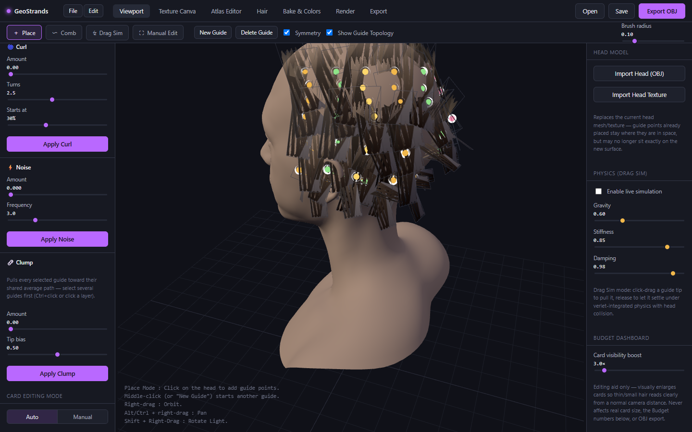

### Step 4: Fine-tune individual cards (optional)

Switch the toolbar to **Manual Edit** and click a card to select it. Click it again to pick a vertex, edge or face (press 1, 2 or 3 to switch). Then press **G** (grab), **S** (scale) or **R** (rotate), optionally followed by **X / Y / Z** to lock an axis. Left-click or Enter confirms, and right-click or Esc cancels. The Manual Card Editor panel also has numeric position and rotation fields, **Subdivide (+1 row)**, **Delete This Card** and optional card gravity.

---

## 3. Styling with Comb and Drag Sim physics

Both tools act on the **selected guide** (click one in the list first). **Brush radius** in the toolbar sets how far from the cursor points are affected.

### Comb

1. Select a guide and switch to **Comb**.
2. Left-click-drag across the head near the guide. Points inside the brush radius are pushed along with the cursor, with falloff toward the edge of the brush, and are gently pulled back onto the scalp surface so they don't sink in or float off.
3. With **Symmetry** on, the mirrored twin gets the mirrored comb stroke.

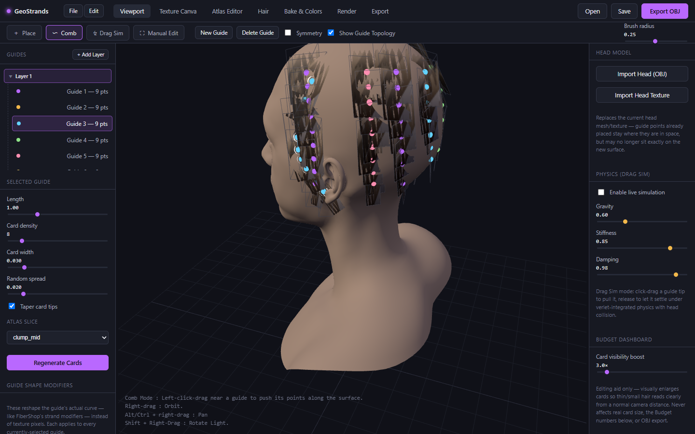

### Drag Sim

1. Switch to **Drag Sim**.
2. Tick **Enable live simulation** in *Physics (Drag Sim)*, or press **Space** to toggle it.
3. Left-click-drag near a guide point to pull it. When you let go, the guide settles under Verlet physics with head collision. Roots stay pinned to the scalp, and cards follow the guides every frame.

| Slider | Effect |
| --- | --- |
| **Gravity** | How hard strands are pulled down (0 to 2). |
| **Stiffness** | How strongly each segment keeps its length and shape (0.1 to 1). |
| **Damping** | How quickly motion dies down (0.8 to 1; lower settles faster). |

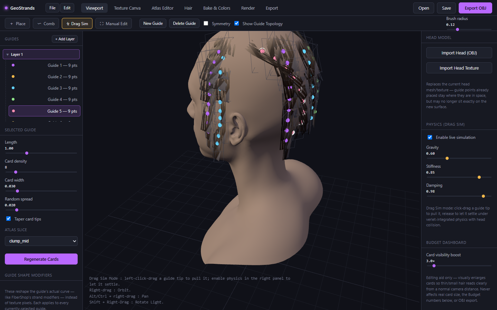

> While live simulation is on, gravity acts on **all** guides, not only the one you drag. Turn it off (Space) once the groom has settled, so it stays put while you do other work. Ctrl+Z undoes a drag.

---

## 4. Creating a strand texture and atlas

### Step 1: Paint a strand texture (Texture Canva tab)

1. Open **Texture Canva**. The canvas is 512×512 with a transparent background.
2. Choose a tool: **Paint Brush** (B), **Fill**, **Pen** (P), **Eraser** (E) or **Gradient** (G), the last with linear, radial, box, diamond, ellipse or triangle shapes.
3. Set **Brush size** and **Opacity**, pick colors from the **Palette** (add more with **+ Color**), and choose a **Brush texture** (Smooth, Textured, Ink, Marker, Watercolor, or an imported PNG/JPG brush).
4. Under **Width Profile**, choose a taper such as *Taper end only* so each stroke thins out like a strand. *Custom* lets you draw the width curve yourself.
5. Paint vertical strokes from top (root) to bottom (tip).
6. Turn on **Modifiers** on the right. They are recomputed from your strokes every time and never stack:
   - **Root → Tip Gradient**: recolors from a root color to a tip color.
   - **Noise / Speckle**: *Linear* style gives hair-strand grain at an adjustable angle.
   - **Highlight Bands**: band count and strength.
   - **Opacity Falloff**: fades alpha toward the tips.
   - **Hue Variation**.
7. **View as** lets you inspect the alpha, luminance or individual RGB channels.

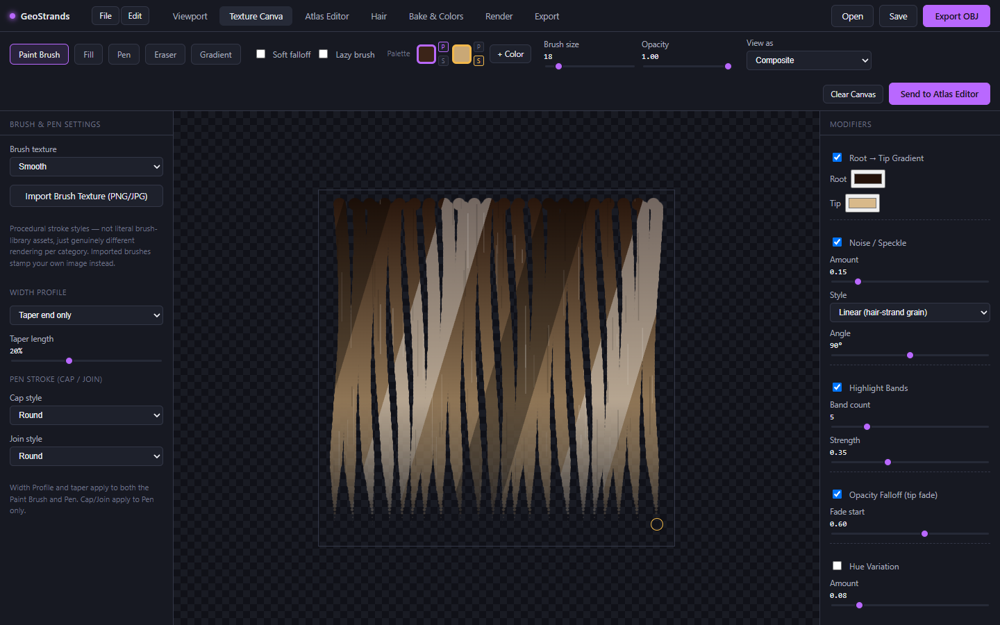

### Step 2 (optional): Adjust colors (Bake & Colors tab)

**Bake & Colors** mirrors the Texture Canva painting and previews brightness, contrast, saturation, hue shift, invert, a two-color **Gradient Remap** and a **Solid Color** pass live. **Bake Into Texture** writes the adjustments in permanently. Baking can't be undone, so export or save first if you want to keep the unbaked version.

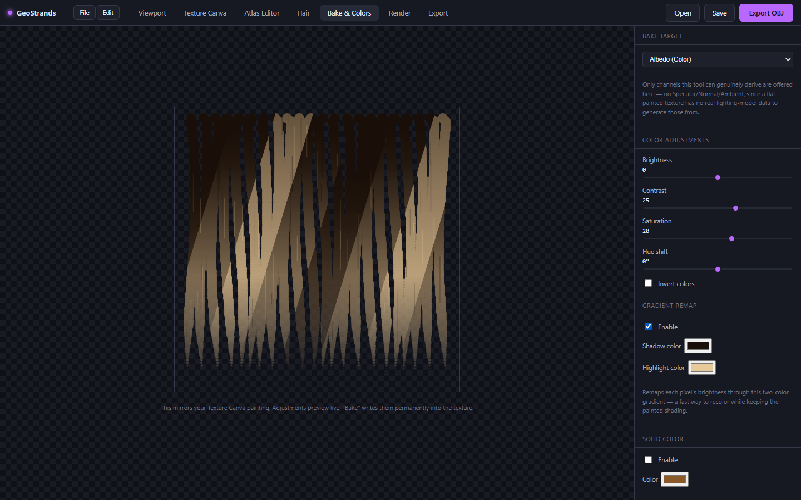

### Step 3: Tag atlas regions (Atlas Editor tab)

1. In Texture Canva, press **Send to Atlas Editor**. The painting becomes the atlas and the app switches tabs. You can also bring in a finished atlas with **Import Atlas (PNG / JPG / PSD)**. PSD support reads the composite image where possible; if a PSD fails, flatten it and export as PNG.
2. Drag a rectangle over one clump on the atlas.
3. Type a **Region name** and press **Tag Selection as Region**.
4. Repeat for each clump. Regions appear in *Tagged Regions* with a thumbnail, and the ✕ button deletes one. **Clear All** removes them all, and Ctrl+Z undoes region changes in this tab.
5. If the painting appears upside down on the cards, tick **Flip texture vertically**. The cards rebuild with each strip flipped inside its region, and exports keep the flip. Guides set to *none* are not affected.

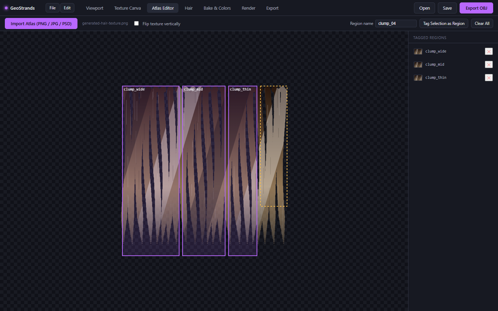

### Step 4: Assign a slice to guides

Back in **Viewport**, select guides (a whole layer, or Ctrl+click several), pick the region in **Atlas slice** and press **Regenerate Cards**. The cards' UVs are remapped to that region, with alpha testing for the strand cut-out.

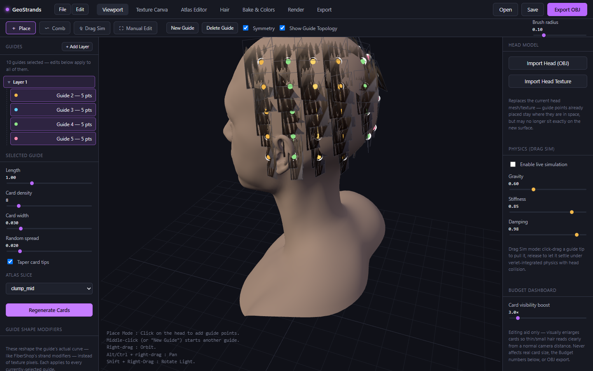

Mixing slices (wide clumps underneath, thin strands on top) is easiest with one layer per slice.

---

## 5. Previewing and rendering

### Hair tab

The **Hair** tab has its own camera, so you can orbit it without disturbing the Viewport camera, and it shows global adjustments:

- **Tint**: multiplies every card's texture by a color. White means no tint.
- **Emissive**: a self-glow color (pick it from the hue strip or the color box) and its intensity.
- **Roughness**: 0 is glossy, 1 is matte.
- **Batch multipliers**: *Density ×*, *Spread ×* and *Taper override* are applied once to every guide by **Apply to All Guides & Regenerate**. The multipliers then reset to 1, and the step is undoable.
- **Summary**: layer, guide, card and triangle totals.

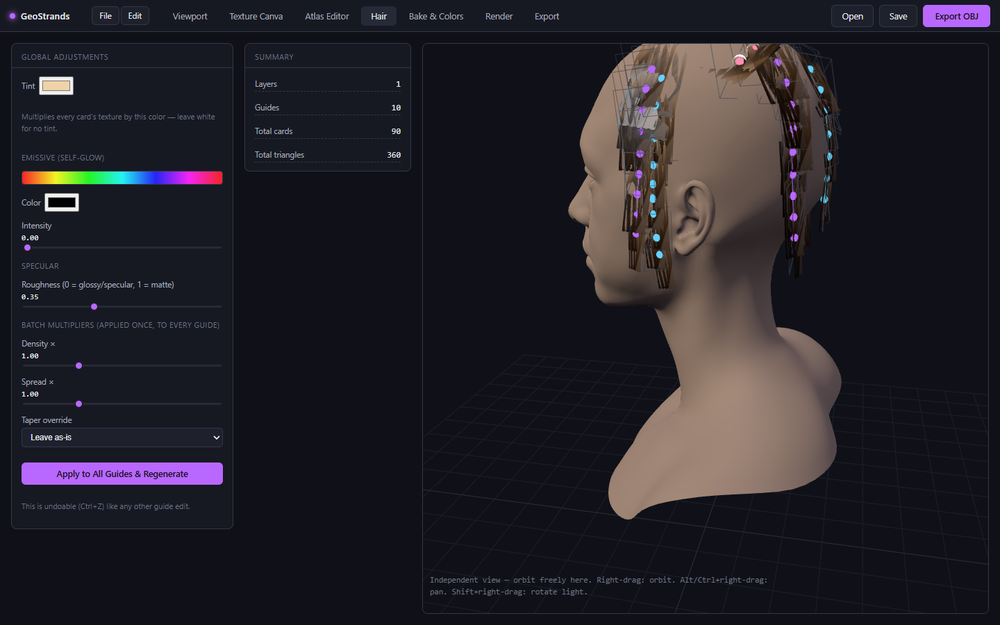

### Render tab

The **Render** tab is a final-look preview, also with its own camera:

- **Scene / Lighting**: background color, ambient (hemisphere) intensity, key light intensity and color. Shift+right-drag rotates the key light in any of the three 3D views.
- **Render Quality**: *Standard* or *High Fidelity*. High Fidelity raises the pixel ratio for sharper, supersampled output.
- **Soft shadows**: hair casts shadow-mapped shadows onto the head.
- **Ambient occlusion**: screen-space contact darkening.
- **Filmic tone mapping (ACES)** with **Exposure**.
- **Bloom**: strength, radius and threshold.
- **Show stats overlay**: FPS, guides, cards, quads and triangles. The overlay appears in the **Viewport** tab's 3D view, and in the Render preview while the Render tab is open. The settings column scrolls on its own, so the preview stays in view while you reach the lower options.

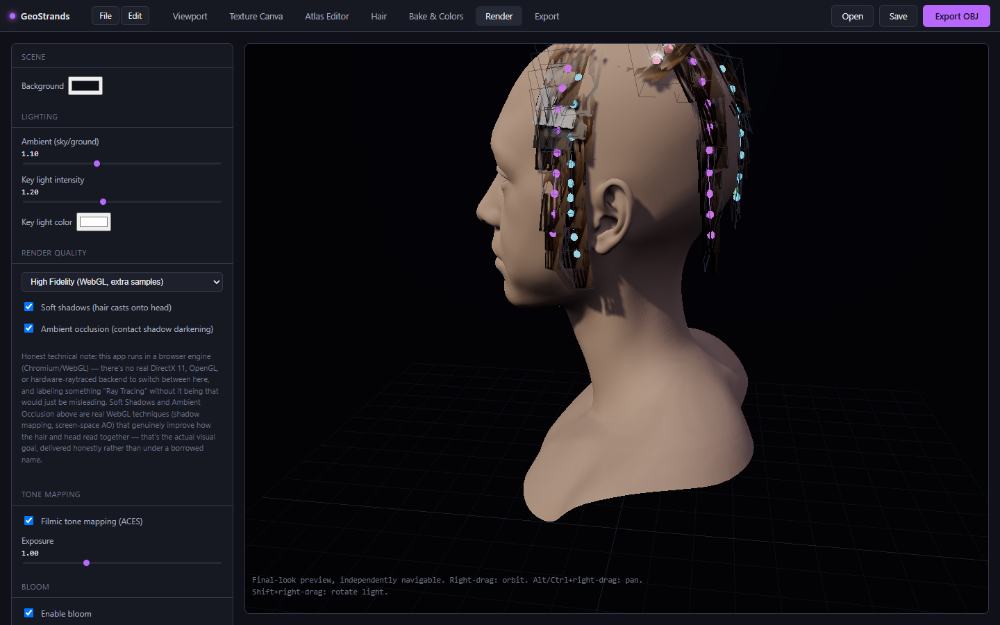

The app states this itself: it is WebGL in a browser. Shadows and AO are real-time techniques, not ray tracing.

### Budget Dashboard

The **Budget Dashboard** (bottom of the Viewport's right panel) counts what you would export:

- **Cards, Quads, Triangles, Vertices**: triangles are the GPU cost. Cards are two-sided, so a single-row card is 2 quads, 4 triangles and 8 vertices.
- **Atlas texture**: resolution and estimated memory (RGBA8 plus mipmaps).
- **Target card budget** (20 to 600): the status line reads *Within budget* up to 85% of the target, *Near budget* up to 100%, and *Over budget* beyond that.

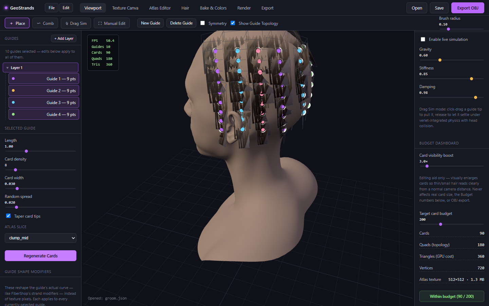

---

## 6. Exporting to engines

Everything is on the **Export** tab. In the browser build, files go to your normal **Downloads** folder.

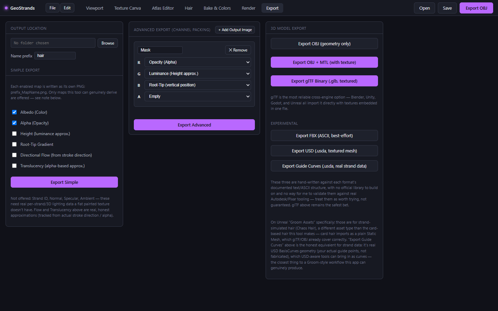

### 3D models

| Button | Output | Notes |
| --- | --- | --- |
| **Export OBJ (geometry only)** | `hair-cards.obj` | Same as the title-bar **Export OBJ** button. Plain card geometry. |
| **Export OBJ + MTL (with texture)** | `hair-cards.obj`, `hair-cards.mtl`, `hair-cards_albedo.png` | The texture file is written only when an atlas is loaded. |
| **Export glTF Binary (.glb, textured)** | `hair-cards.glb` | One file with the texture embedded. The most reliable cross-engine option. Passes the Khronos glTF validator with no errors or warnings. |
| **Export FBX (ASCII, best-effort)** | `hair-cards.fbx` | Experimental. Written by hand against the ASCII FBX structure. It loads cleanly in three.js but has not been tested in Autodesk tools or Blender, and it carries no texture. |
| **Export USD (.usda, textured mesh)** | `hair-cards.usda` + `hair-cards_usd_albedo.png` | Experimental. The texture file is written only when an atlas is loaded. Passes the OpenUSD validator. |
| **Export Guide Curves (.usda, real strand data)** | `hair-guides.usda` | Experimental. Your guide points as USD `BasisCurves`, for USD-aware tools that work with curves. |

All model exports use real card sizes. The on-screen visibility boost is never exported.

> On Unreal **Groom** assets: those are for strand-simulated hair, a different asset type. Card hair imports as an ordinary static mesh through glTF or OBJ. *Export Guide Curves* is the closest thing to strand data GeoStrands produces.

### Texture maps (Simple Export)

1. Click **Browse** (in the browser this just selects *Downloads*) and set a **Name prefix**.
2. Tick the maps you want:
   - **Albedo (Color)**: `prefix_Albedo.png`
   - **Alpha (Opacity)**: `prefix_Alpha.png`
   - **Height (luminance approx.)**: `prefix_Height.png`
   - **Root-Tip Gradient**: `prefix_RootTip.png`, a vertical root-to-tip ramp
   - **Directional Flow**: `prefix_Flow.png`, tracked from your actual brush and pen stroke directions
   - **Translucency (alpha-based approx.)**: `prefix_Translucency.png`
3. Press **Export Simple**.

These maps are built from the **Texture Canva** painting. If nothing is painted there and an atlas is loaded, they are built from the atlas image instead, so you don't get blank maps. The app deliberately doesn't offer Normal, Specular, AO or Strand ID maps, because a flat painted texture has no data to derive them from.

### Channel-packed maps (Advanced Export)

**Advanced Export** packs any source (alpha, luminance, a single RGB channel, root-tip, flow X/Y, translucency, black, white or empty) into the R, G, B and A channels of one PNG. The default *Mask* image packs Alpha / Height / Root-Tip / Empty. Use **+ Add Output Image** for more packed textures, then **Export Advanced**. Each one is saved as `prefix_<Name>.png`.

---

## 7. Keyboard and mouse shortcuts

These come from the app's own input handlers. Key shortcuts are ignored while a text field, slider or drop-down has focus.

### Anywhere

| Input | Action |
| --- | --- |
| **Ctrl+Z** | Undo. Paint strokes in Texture Canva, region edits in Atlas Editor, guide and layer edits everywhere else. |
| **Ctrl+S** | Save project. |
| **Ctrl+,** | Open Preferences (UI colors, autosave). |
| **Tab** | Cycle to the next tab, in the current tab order. |
| **Space** | Toggle live physics simulation. |
| **Delete / Backspace** | Delete the selected card in Manual Edit; otherwise delete the selected guide(s). |

### 3D views (Viewport, Hair, Render)

| Input | Action |
| --- | --- |
| **Right-drag** | Orbit. |
| **Alt+right-drag** or **Ctrl+right-drag** | Pan. |
| **Shift+right-drag** | Rotate the key light around the head. |
| **Mouse wheel** | Zoom. |
| **Middle-click** (Viewport) | Start a new guide, in any mode. |
| **Left-click / drag** (Viewport) | Use the current tool (Place, Comb, Drag Sim, Manual Edit). |

### Manual Edit mode (Viewport tab, with a card selected)

| Key | Action |
| --- | --- |
| **1 / 2 / 3** | Select vertices / edges / faces. |
| **G / S / R** | Grab / scale / rotate the selection. |
| **X / Y / Z** | During G/S/R, lock to an axis. Press again to unlock. |
| **Enter** or **left-click** | Confirm the transform. |
| **Esc** or **right-click** | Cancel the transform. |

### Texture Canva tab

| Key | Action |
| --- | --- |
| **B** | Paint Brush |
| **E** | Eraser |
| **G** | Gradient |
| **P** | Pen |
| **Enter** / **double-click** | Finish the current Pen stroke. |
| **Esc** | Cancel the current Pen stroke. |

---

GeoStrands is made by Charlize Pauli and released under the MIT license. It is a work in progress; see [EXAMPLES.md](EXAMPLES.md) for worked examples.
